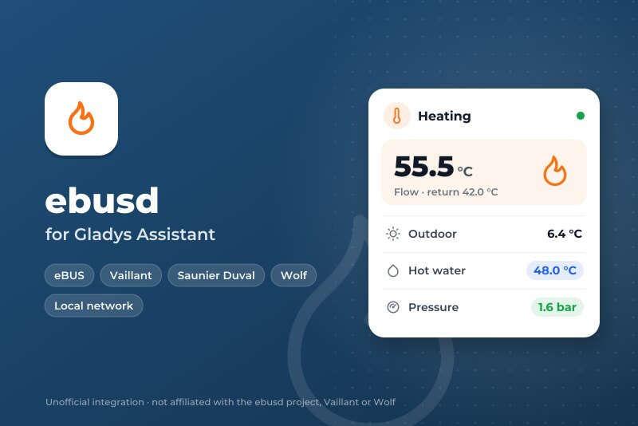
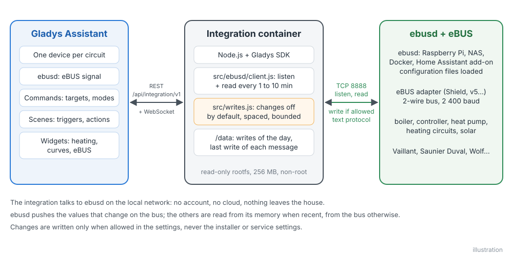
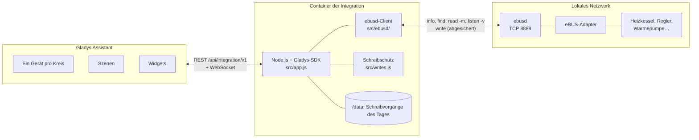
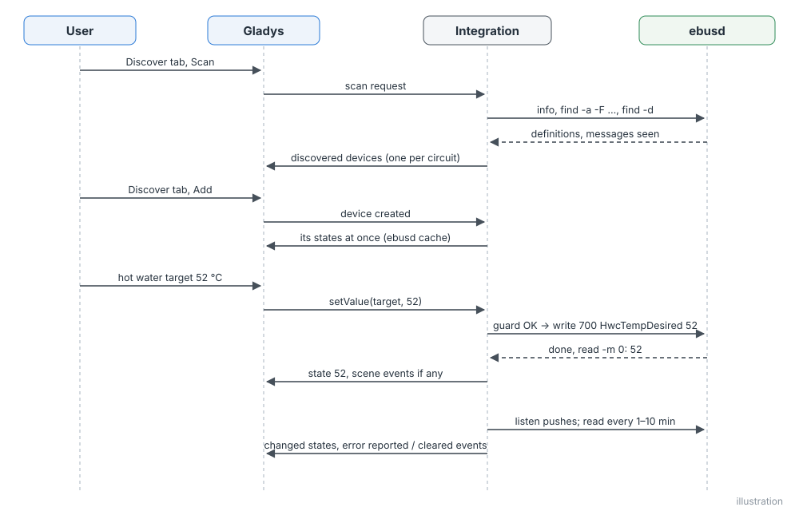
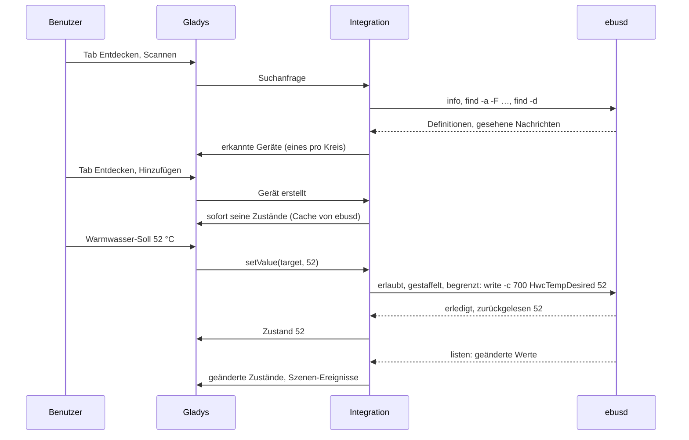
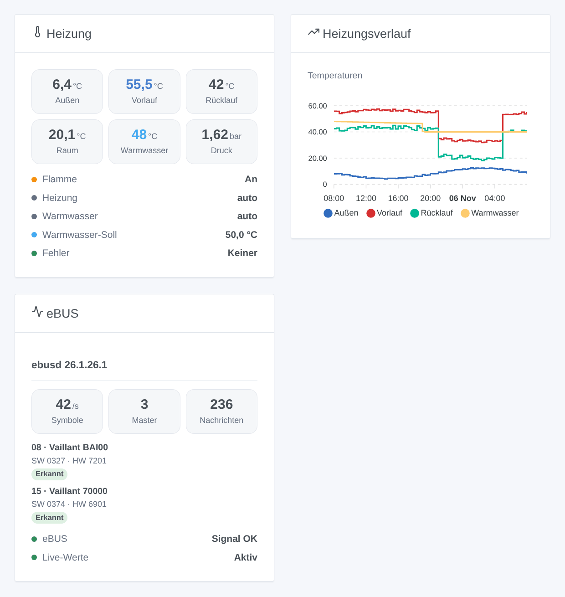
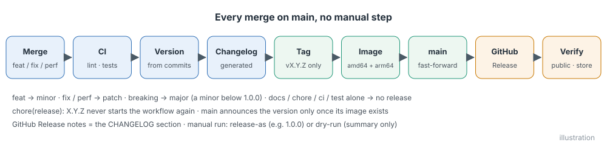

# ebusd für Gladys Assistant

[English](README.md) | [Français](README.fr.md) | **Deutsch** | [Español](README.es.md)

[](LICENSE)
[](https://github.com/William-De71/gladys-ebusd/releases)
[](https://github.com/William-De71/gladys-ebusd/actions/workflows/release.yml)
[](https://gladysassistant.com)



Ihre eBUS-Heizung (Vaillant, Saunier Duval, AWB, Bulex, Wolf, Kromschröder…) in Gladys Assistant, über den freien Dienst [ebusd](https://github.com/john30/ebusd), im lokalen Netzwerk. Heizkessel, Wärmepumpe und Regler werden zu Gladys-Geräten, mit Live-Werten, drei Widgets, Szenen-Auslösern und sorgfältig abgesicherten Änderungen. Inoffiziell, weder mit dem ebusd-Projekt noch mit den genannten Marken verbunden.

## Funktionen

- **Spricht mit ebusd im lokalen Netzwerk**, über dessen TCP-Port (standardmäßig 8888), optional mit Benutzer und Geheimnis aus einer ebusd-Zugriffsdatei.
- **Ein Gladys-Gerät pro eBUS-Kreis**, den ebusd kennt: der Heizkessel (`bai`), die Wärmepumpe (`hmu`), der Regler (`700`, `720`, `ctlv2`…), die Heizkreise, die Rundruf-Werte, benannt nach dem Modell, das sie melden; dazu ebusd selbst mit dem eBUS-Signal.
- **Nur nützliche Funktionen**: die Werte mit aussagekräftigem Namen, die ebusd auf dem Bus gesehen hat (Temperaturen, Druck, Flamme, Modulation, Leistung, Energie, Stunden, Starts, Betriebsarten, aktueller Fehler), und die bekannten Nachrichten von Vaillant-Anlagen – oder jeder Wert, den ebusd gesehen hat, plus alle Nachrichten, die Sie angeben.
- **Live-Werte**: ebusd schickt jeden Wert, der sich auf dem Bus ändert, sofort; die übrigen werden alle 1 bis 10 Minuten gelesen, aus dem Speicher von ebusd, wenn er aktuell genug ist, sonst vom Bus.
- **Änderungen standardmäßig aus**: Wenn erlaubt, lassen sich Raum-Solltemperaturen, Warmwasser-Soll, Ein/Aus und Betriebsarten ändern, die der Regler für jeden freigibt, in festen Grenzen, nie die Installateur- oder Service-Einstellungen, zeitlich gestaffelt und gezählt.
- **Drei Dashboard-Widgets**: die Heizung auf einen Blick, Temperaturverläufe, der eBUS und seine Geräte.
- **Vier Szenen-Auslöser** (Fehler gemeldet, Fehler behoben, ebusd verloren, ebusd zurück) und **zwei Szenen-Aktionen** (eine beliebige Nachricht lesen, eine Nachricht schreiben).
- Englisch, Französisch, Deutsch und Spanisch.

## Funktionsweise





**Protokoll.** ebusd beantwortet Textbefehle auf seinem TCP-Port, eine Zeile pro Anfrage, jede Antwort endet mit einer Leerzeile. Die Integration nutzt `info` (Version, Signal, die gesehenen Geräte und die jeweils geladene Konfigurationsdatei), `find -a -F …` (jede Nachrichtendefinition mit Feldern, Einheiten und Wertelisten), `find -d` (die Nachrichten, zu denen Daten vorliegen), `read -m <seconds> -v` (ein Wert aus dem Cache von ebusd, wenn er aktuell genug ist, sonst vom Bus), `listen -v` (die Werte, sobald sie sich ändern) und `write` (eine Änderung, abgesichert). HTTP-Port und MQTT von ebusd werden nicht benötigt.

**Erkennung.** Jeder Kreis von ebusd wird zu einem Gerät. ebusd lädt die Konfiguration eines Geräts einige Minuten, nachdem es dieses auf dem Bus gesehen hat: Die Integration prüft in der ersten Stunde alle 10 Minuten erneut, danach stündlich, und bietet neue Geräte im Tab „Entdecken“ an.

**Schreiben.** Siehe [Konfiguration](#konfiguration). Ein Wert ist schreibbar, wenn der Regler eine passende, für jeden offene Schreibnachricht hat (keine Zugriffsebene „install“ oder „service“) mit genau einem Feld: eine Raum-Solltemperatur (5–30 °C), das Warmwasser-Soll (35–70 °C), ein Ein/Aus oder eine Liste benannter Betriebsarten. Alles andere ist nur lesbar.





### Geräte und Funktionen

| Gladys-Gerät                        | Funktionen                                                                                                                                                                                                                                                                                        |
| ----------------------------------- | ------------------------------------------------------------------------------------------------------------------------------------------------------------------------------------------------------------------------------------------------------------------------------------------------- |
| `daemon:ebusd` — ebusd              | `signal`: der Adapter hört den eBUS (ein / aus)                                                                                                                                                                                                                                                   |
| `circuit:<name>` — eines pro Kreis  | eine Funktion pro nützlichem Feld: Temperaturen (°C), Druck (bar, mbar), Modulation und Feuchte (%), Leistung (W, kW), Energie (Wh, kWh, MWh), Spannung, Strom, Stunden, Minuten, Sekunden, Starts, ein / aus (Flamme, Pumpe…), benannte Werte (Betriebsarten, Zustände), der aktuelle Fehlercode |
| schreibbar, wenn Änderungen erlaubt | Raum-Solltemperaturen (Thermostat, 5–30 °C), Warmwasser-Soll (Warmwasserbereiter, 35–70 °C), Ein/Aus und benannte Betriebsarten (Auswahl), die der Regler für jeden freigibt                                                                                                                      |

Beispiel mit einem Vaillant-Heizkessel und einem VRC 700: der Heizkessel `bai` (Vorlauf-, Rücklauf-, Außen-, Warmwasser- und Speichertemperatur, Wasserdruck, Flamme, Brennermodulation, Betriebsstunden und Brennerstarts für Heizung und Warmwasser, aktueller Fehler) und der Regler `700` (Außen- und Raumtemperatur, Raum-Solltemperaturen Tag / Nacht, Betriebsarten Heizung und Warmwasser, Warmwasser-Soll). Externe IDs: `ext:<selector>:circuit:<circuit>`, Funktionen `…:<message>.<field>`, in Kleinbuchstaben.

## Transport

`transports: ["local"]`: Der Katalog zeigt das Badge **lokal**. Nichts verlässt das lokale Netzwerk: kein Konto, keine Cloud. Jedes Gerät meldet **lokal**, solange ebusd antwortet, sonst **nicht erreichbar**; es gibt weder eine lokale Präferenz noch einen eingeschränkten Modus.

## Widgets



- **Heizung**: Außen-, Vorlauf-, Rücklauf-, Raum- und Warmwassertemperatur, Druck, Modulation (die Kacheln folgen den Gerätezuständen live), dann Flamme, Betriebsarten Heizung und Warmwasser, Warmwasser-Soll, aktueller Fehler, eBUS-Signal.
- **Heizungsverlauf**: Außen-, Vorlauf-, Rücklauf- und Warmwassertemperatur über 24 Stunden, 3 oder 7 Tage (sobald die Geräte hinzugefügt sind).
- **eBUS**: ebusd-Version, Symbolrate, Master, Nachrichten, die auf dem Bus gesehenen Geräte mit Modell, Software, Hardware und ob ebusd sie kennt, das Signal und die Live-Aktualisierungen.

## Szenen-Auslöser und -Aktionen

| Auslöser         | Wann                                                                         | Daten                                                       |
| ---------------- | ---------------------------------------------------------------------------- | ----------------------------------------------------------- |
| `error_reported` | ein Gerät meldet einen Fehlercode, den es vorher nicht meldete (F.28, F.75…) | `device`, `device_name`, `circuit`, `message`, `error_code` |
| `error_cleared`  | das Gerät meldet ihn nicht mehr                                              | dieselben                                                   |
| `ebusd_offline`  | ebusd antwortet 3 Minuten lang nicht                                         | `address`                                                   |
| `ebusd_online`   | ebusd antwortet wieder                                                       | `address`                                                   |

| Aktion        | Was sie tut                                                                                                      | Ausgaben                            |
| ------------- | ---------------------------------------------------------------------------------------------------------------- | ----------------------------------- |
| `read_value`  | liest eine beliebige Nachricht über Kreis und Namen (vom Bus, wenn der Wert von ebusd zu alt ist)                | `value`, `number`, `unit`, `fields` |
| `write_value` | schreibt eine für jeden offene Nachricht, wenn Änderungen erlaubt sind (gestaffelt und gezählt wie alle anderen) | `result`                            |

Beispiele:

- Wenn der Heizkessel einen Fehler meldet → eine Nachricht mit `{{triggerEvent.data.error_code}}` senden.
- Wenn ebusd nicht mehr antwortet → benachrichtigen, das Haus wird womöglich nicht mehr geheizt.
- Jeden Morgen → `bai WaterPressure` lesen; unter 1 bar → daran erinnern, Wasser in der Heizung nachzufüllen.

## Voraussetzungen

- Gladys Assistant **5.3.0 oder neuer** (Katalog-Suchbegriffe von Gladys 5.3, Dashboard-Widgets sowie Szenen-Auslöser und -Aktionen von Integrationen; ältere Instanzen können die Integration nicht installieren).
- [ebusd](https://github.com/john30/ebusd) läuft mit einem eBUS-Adapter (zum Beispiel dem eBUS Adapter Shield), mit seinen Konfigurationsdateien (Standard, `--scanconfig`) und mit einem von Gladys erreichbaren TCP-Port (nicht mit `--localhost` gestartet).

## Installation

- **Aus dem Store**: Integrationen → „ebusd“ suchen → Installieren.
- **Über die Repository-URL**: Integrationen → Integration installieren → `https://github.com/William-De71/gladys-ebusd` einfügen.
- **Entwicklermodus**: Integrationen → Integration installieren → Entwicklermodus, mit dem Manifest eines Builds (die Zusammenfassung des Workflows „Build and publish image“ zeigt es).

## Konfiguration

| Feld             | Typ     | Standard | Bedeutung                                                                                                       |
| ---------------- | ------- | -------- | --------------------------------------------------------------------------------------------------------------- |
| `host`           | string  | leer     | IP-Adresse oder Name des Rechners, auf dem ebusd läuft (nicht `localhost`), `:port` erlaubt                     |
| `port`           | number  | `8888`   | TCP-Port von ebusd (`--port`)                                                                                   |
| `user`, `secret` | string  | leer     | nur mit einer ebusd-Zugriffsdatei (`--aclfile`)                                                                 |
| `poll_interval`  | select  | `120`    | Sekunden zwischen zwei Lesungen: 60, 120, 300, 600                                                              |
| `messages`       | select  | `useful` | `useful`: die nützlichen Werte, die ebusd gesehen hat, und die bekannten; `all`: jeder gesehene Wert            |
| `extra_messages` | string  | leer     | Nachrichten, die immer angeboten und gelesen werden, `circuit.Message`, durch Kommas getrennt (`bai.PumpPower`) |
| `allow_writes`   | boolean | `false`  | Änderungen erlauben (Raum- und Warmwasser-Soll, Ein/Aus, Betriebsarten), mit dem Schutz unten                   |
| `language`       | select  | `en`     | Sprache der Geräte- und Funktionsnamen, der Textzustände und der Szenenfehler                                   |
| `debug_logs`     | boolean | `false`  | ausführliches Log: jeder an ebusd gesendete Befehl und seine Antwort (nie das Geheimnis)                        |

Schutz bei Änderungen: Ein bereits gesetzter Wert wird nie geschrieben; dieselbe Nachricht höchstens einmal pro Minute; 100 Änderungen pro Tag (gezählt in `/data/writes.json`); Grenzen: Raum 5–30 °C, Warmwasser 35–70 °C, Schritte von 0,5 °C; nie eine Nachricht mit Zugriffsebene; der Wert wird zurückgelesen.

Schaltfläche der Konfigurationsseite: **ebusd testen und Geräte suchen** (verbindet sich, prüft das Signal, listet die gefundenen Geräte mit ihrer Anzahl an Werten).

## Verwendung

1. Starten Sie ebusd mit Ihrem Adapter; prüfen Sie mit `ebusctl info`, dass es Ihre Geräte sieht und deren Konfiguration geladen hat.
2. Installieren Sie die Integration, geben Sie die Adresse von ebusd ein und drücken Sie **ebusd testen und Geräte suchen**.
3. Fügen Sie die Geräte im Tab **Entdecken** hinzu, die Widgets einem Dashboard, erstellen Sie Ihre Szenen. Erlauben Sie Änderungen nur, wenn Sie sie brauchen.

Die Benutzerdokumentation finden Sie in [docs/de.md](docs/de.md) ([en](docs/en.md), [fr](docs/fr.md), [es](docs/es.md)).

## Grenzen

- **Nie an einem echten eBUS getestet**: Alles wird gegen die Antworten eines echten ebusd 26.1 getestet (offizielles Docker-Image, Vaillant-Heizkessel BAI00 und VRC 700, auf einem eingespeisten Bus gemeldet), die ein simuliertes ebusd auf einem echten lokalen Socket wiedergibt. Rückmeldungen willkommen, mit Ihrem `ebusctl info`.
- Die Funktionsnamen stammen von ebusd (`Flow temp desired`), außer bei den bekannten Nachrichten, die übersetzt sind.
- Werte ohne Gladys-Kategorie (Datum, Uhrzeit, Durchfluss in l/min, rohe Zahlen ohne Einheit) werden nicht angeboten; die Szenen-Aktion `read_value` liest sie.
- Schreibbar sind nur Raum- und Warmwasser-Soll, Ein/Aus und Betriebsarten; keine Zeitprogramme, keine Heizkurve, keine Urlaubsdaten.

## Lokale Entwicklung

```bash
npm install
GLADYS_HOST_API_URL=http://localhost:1443 \
  GLADYS_INTEGRATION_TOKEN=… GLADYS_INTEGRATION_SELECTOR=… \
  EBUSD_DATA_DIR=./data DEBUG=gladys-integration-sdk node index.js
```

Ein echtes ebusd ohne Adapter zum Ausprobieren (die Scan-Antworten werden eingespeist):

```bash
docker run -d --name ebusd-lab -p 18888:8888 john30/ebusd:latest -f \
  --device=enh:127.0.0.1:9999 --nodevicecheck --scanconfig --accesslevel='*' \
  --inject FF08070400/0AB5424149303003277201
```

| Variable                                                                         | Standard           | Zweck                                     |
| -------------------------------------------------------------------------------- | ------------------ | ----------------------------------------- |
| `GLADYS_HOST_API_URL`, `GLADYS_INTEGRATION_TOKEN`, `GLADYS_INTEGRATION_SELECTOR` | von Gladys gesetzt | Verbindung zur Host-API von Gladys        |
| `EBUSD_DATA_DIR`                                                                 | `/data`            | Ordner von `writes.json`                  |
| `DEBUG`                                                                          | nicht gesetzt      | `gladys-integration-sdk` für die SDK-Logs |

| Skript                            | Funktion                                             |
| --------------------------------- | ---------------------------------------------------- |
| `npm test`                        | die Tests (`node --test`), nichts verlässt 127.0.0.1 |
| `npm run lint`                    | ESLint                                               |
| `npm run format` / `format:check` | Prettier                                             |
| `docs/illustrations/render.sh`    | die Widget-Illustrationen neu erzeugen               |
| `scripts/build-cover.sh`          | `cover.jpg` aus `docs/assets/cover.svg` neu erzeugen |

## Tests

`npm test` lässt die ganze Integration gegen das simulierte Gladys des SDK und ein simuliertes ebusd auf einem echten lokalen Socket laufen, gespeist mit den echten Antworten von ebusd 26.1 (`test/fixtures`). Abgedeckt: das Protokoll (Antworten, Fehler, CSV in Anführungszeichen, Wertzeilen von `read`, `find` und `listen`, `info`), der Katalog (nützliche Nachrichten, nie die von install / service, Gladys-Kategorien und -Einheiten, schreibbare Sollwerte und ihre Grenzen), der Client (immer nur ein Befehl, Timeouts, Wiederverbindung, Authentifizierung, mit ebusd neu gestarteter Listener), die Erkennung, Werte aus dem Cache und live, Lesungen, Schreiben und jeder Schutz (Schalter, Grenzen, gleicher Wert, zeitlicher Abstand, Tageskontingent über Neustarts hinweg), Szenen-Auslöser und -Aktionen, die drei Widgets geprüft mit `validateWidgetContent`, verlorenes und zurückkehrendes ebusd, Einstellungen. Eine Erkennungs-Referenz fixiert die externen IDs und die Gladys-Felder; das Manifest wird gegen den Code, die Übersetzungen und das Release-Skript geprüft. Die CI baut außerdem das Image und startet es wie Gladys (schreibgeschützt, 256 MB, ohne Netzwerk).

## Release-Prozess

Jeder Merge auf `main` veröffentlicht ein Release, wenn seine Commits es rechtfertigen, ohne manuellen Schritt:




- `feat` → Minor, `fix` / `perf` → Patch, `!` oder `BREAKING CHANGE:` → Major (ein Minor unter 1.0.0). `docs`, `chore`, `ci`, `test`, `style`, `refactor`, `build` allein veröffentlichen nichts.
- Der Titel des Pull Requests wird zum Squash-Commit, also zur Changelog-Zeile: auf Englisch, für den Benutzer (`feat(widgets): …`). `pr-title.yml` prüft ihn. `CHANGELOG.md` nie von Hand bearbeiten.
- Das Image existiert, bevor `main` seine Version ankündigt (der Store indexiert `main`).
- 1.0.0 ist eine manuelle Entscheidung: Actions → Release → Run workflow, `release-as: 1.0.0`. `dry-run` zeigt Version und Changelog, ohne zu veröffentlichen.
- **Geschütztes `main`**: Das Release pusht einen Commit auf `main`. Bei einem Branch-Schutz oder Ruleset, das Pull Requests oder Status-Checks verlangt, erlauben Sie GitHub Actions die Umgehung (oder nutzen Sie eine GitHub App), sonst stoppt das Release nach dem Image.
- Nach dem ersten Release das Paket bei Bedarf öffentlich machen: Package settings → Change visibility → Public.

## Fehlerbehebung

- **„ebusd antwortet nicht“**: Prüfen Sie Adresse und Port; ebusd muss im Netzwerk lauschen (nicht `--localhost`); `localhost` funktioniert aus dem Container der Integration nicht; eine Firewall kann Port 8888 blockieren.
- **„hört nichts auf dem eBUS“**: ebusd läuft, aber der Adapter hat kein Signal: Prüfen Sie den Adapter, seine Verkabelung und `ebusctl state`.
- **Ein Gerät fehlt**: ebusd hat seine Konfiguration noch nicht geladen (`ebusctl info`: kein Teil `loaded`); warten Sie einige Minuten oder suchen Sie erneut.
- **Ein Wert fehlt**: Wählen Sie „Alle, die ebusd gesehen hat“ oder tragen Sie die Nachricht unter „Zusätzliche Nachrichten“ ein.
- **„Änderungen sind deaktiviert“**: Aktivieren Sie **Änderungen erlauben**. **„in … s erneut versuchen“**: Dieselbe Nachricht wurde vor weniger als einer Minute geändert.
- **„hat den Benutzernamen oder das Geheimnis abgelehnt“**: Prüfen Sie die Zugriffsdatei von ebusd.
- Logs: der Tab Logs der Integration. Sie melden immer, wenn ebusd nicht mehr antwortet (mit Grund und Befehl), und was jede Suche gefunden hat; **Ausführliches Log** aktivieren, um zusätzlich jeden Befehl und seine Antwort zu sehen. `DEBUG=gladys-integration-sdk` für die SDK-Details.

## Mitwirken

Issues und Pull Requests sind willkommen. Führen Sie `npm run format:check`, `npm run lint` und `npm test` aus, schreiben Sie den Titel des Pull Requests als Conventional Commit und starten Sie `docs/illustrations/render.sh` nach jeder Änderung eines Widget-Inhalts neu. Eine neue Funktion darf die bestehenden nicht ändern (`test/fixtures/discovery.baseline.json`). Verhält sich eine echte Anlage anders, fügen Sie zuerst ihre Antworten auf `ebusctl info` und `find` zu `test/fixtures` hinzu, dann korrigieren Sie den Code.

## Sicherheit

Siehe [SECURITY.md](SECURITY.md). Das optionale ebusd-Geheimnis ist eine geheime Einstellung von Gladys und wird nie protokolliert. ebusd hat keine Authentifizierung, sofern es nicht mit einer Zugriffsdatei gestartet wird: Betreiben Sie es in einem vertrauenswürdigen Netzwerk, nie aus dem Internet erreichbar. `/data` speichert nur die Schreibvorgänge des Tages. Änderungen sind standardmäßig aus.

## Lizenz

[Apache-Lizenz 2.0](LICENSE), siehe auch [NOTICE](NOTICE). Der Client wurde für dieses Projekt anhand der Dokumentation der TCP-Befehle von ebusd geschrieben; es wurde kein Code von ebusd (GPL-3.0) kopiert; die Test-Fixtures zitieren Konfigurationsdaten von ebusd unter GPL-3.0 (`test/fixtures/README.md`). ebusd ist ein Projekt von John Baier; Vaillant, Saunier Duval, Wolf und die anderen Marken sind Marken ihrer Inhaber; dieses Projekt ist weder mit ihnen verbunden noch von ihnen gebilligt oder unterstützt.
