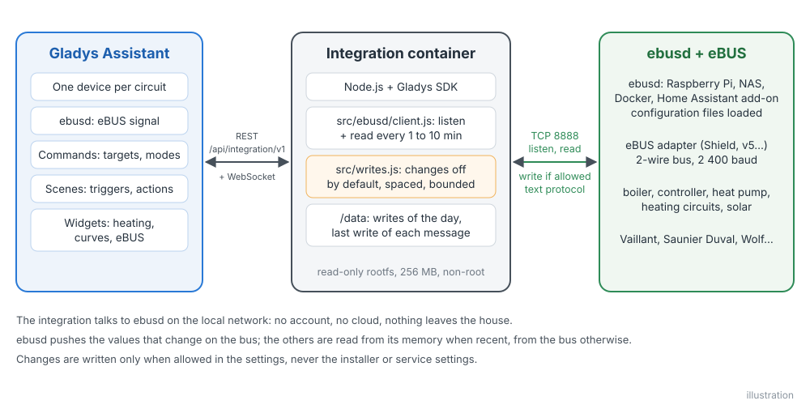
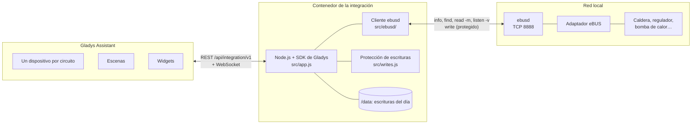
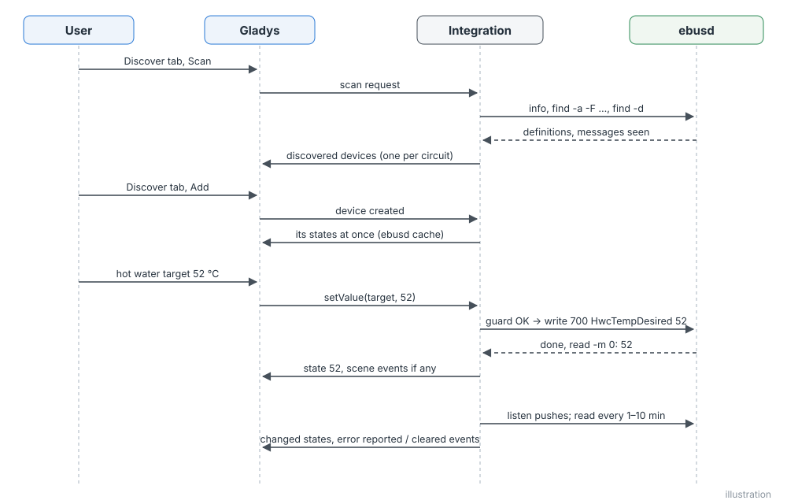
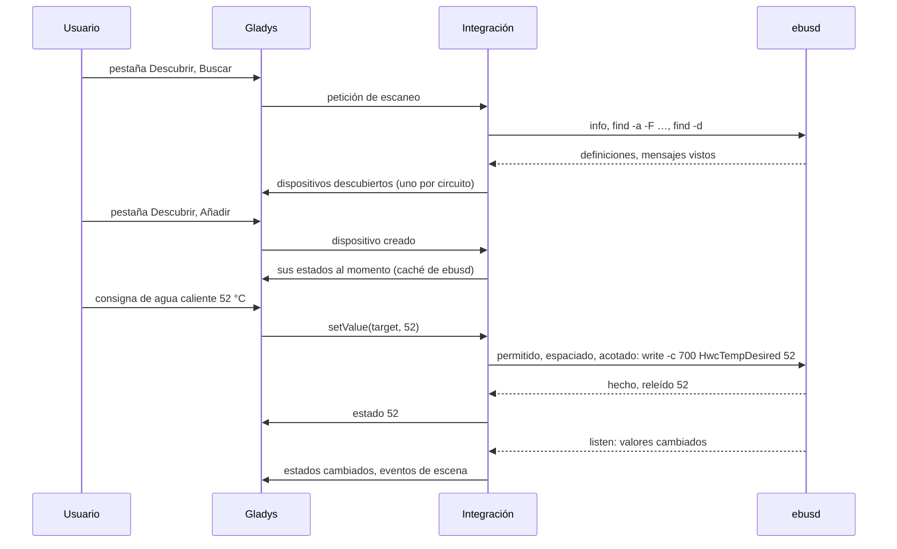
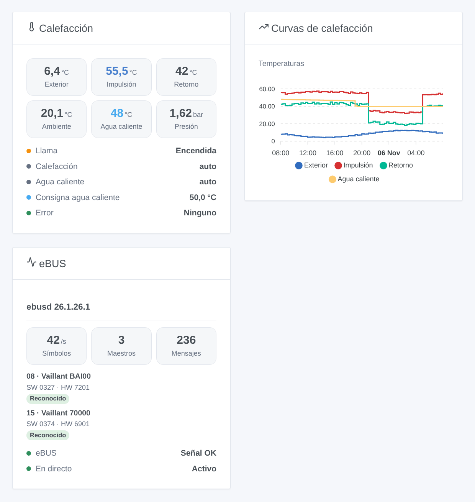
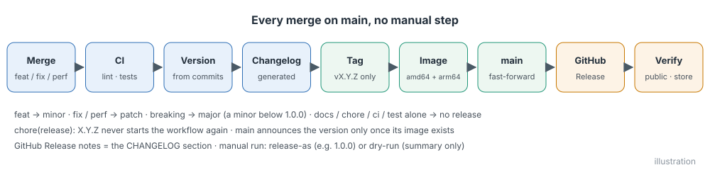

# ebusd para Gladys Assistant

[English](README.md) | [Français](README.fr.md) | [Deutsch](README.de.md) | **Español**

[](LICENSE)
[](https://github.com/William-De71/gladys-ebusd/releases)
[](https://github.com/William-De71/gladys-ebusd/actions/workflows/release.yml)
[](https://gladysassistant.com)


Su calefacción eBUS (Vaillant, Saunier Duval, AWB, Bulex, Wolf, Kromschröder…) en Gladys Assistant, a través del programa libre [ebusd](https://github.com/john30/ebusd), en su red local. La caldera, la bomba de calor y el regulador se convierten en dispositivos de Gladys, con valores en directo, tres widgets, desencadenadores de escena y cambios cuidadosamente protegidos. No oficial, sin relación con el proyecto ebusd ni con las marcas citadas.

## Funciones

- **Dialoga con ebusd en la red local**, por su puerto TCP (8888 por defecto), con el usuario y el secreto opcionales de un archivo de acceso de ebusd.
- **Un dispositivo de Gladys por cada circuito eBUS** que ebusd conoce: la caldera (`bai`), la bomba de calor (`hmu`), el regulador (`700`, `720`, `ctlv2`…), los circuitos de calefacción, los valores difundidos, con el nombre del modelo que anuncian; además del propio ebusd con la señal eBUS.
- **Solo las funciones útiles**: los valores que ebusd ha visto en el bus y que tienen un nombre útil (temperaturas, presión, llama, modulación, potencia, energía, horas, arranques, modos, error actual) y los mensajes conocidos de las instalaciones Vaillant, o bien todos los valores que ebusd ha visto, más los mensajes que usted indique.
- **Valores en directo**: ebusd envía cada valor que cambia en el bus; los demás se leen cada 1 a 10 minutos, de la memoria de ebusd cuando es bastante reciente, del bus en caso contrario.
- **Cambios desactivados por defecto**: una vez permitidos, consignas de ambiente, consigna de agua caliente, encendido/apagado y modos de funcionamiento que el regulador deja cambiar a todos, dentro de límites fijos, nunca los ajustes de instalador o de servicio técnico, espaciados y contados.
- **Tres widgets de panel**: la calefacción de un vistazo, las curvas de temperatura, el eBUS y sus dispositivos.
- **Cuatro desencadenadores de escena** (error indicado, error desaparecido, ebusd perdido, ebusd recuperado) y **dos acciones de escena** (leer cualquier mensaje, escribir un mensaje).
- Inglés, francés, alemán y español.

## Funcionamiento





**Protocolo.** ebusd responde a órdenes de texto en su puerto TCP, una línea por petición y una línea vacía al final de cada respuesta. La integración usa `info` (versión, señal, los dispositivos vistos y el archivo de configuración cargado para cada uno), `find -a -F …` (todas las definiciones de mensajes, con sus campos, unidades y listas de valores), `find -d` (los mensajes que tienen datos), `read -m <seconds> -v` (un valor de la caché de ebusd cuando es bastante reciente, del bus en caso contrario), `listen -v` (los valores enviados a medida que cambian) y `write` (un cambio, protegido). No hacen falta ni el puerto HTTP ni el MQTT de ebusd.

**Descubrimiento.** Cada circuito de ebusd se convierte en un dispositivo. ebusd carga la configuración de un dispositivo unos minutos después de verlo en el bus: la integración vuelve a mirar cada 10 minutos durante la primera hora, luego cada hora, y ofrece los dispositivos nuevos en la pestaña «Descubrir».

**Escrituras.** Véase [Configuración](#configuración). Un valor se puede escribir cuando el regulador tiene un mensaje de escritura correspondiente abierto a todos (sin nivel de acceso «install» ni «service»), con un único campo: una consigna de ambiente (5–30 °C), la consigna de agua caliente (35–70 °C), un encendido/apagado o una lista de modos con nombre. Todo lo demás es de solo lectura.





### Dispositivos y funciones

| Dispositivo de Gladys                       | Funciones                                                                                                                                                                                                                                                                                                 |
| ------------------------------------------- | --------------------------------------------------------------------------------------------------------------------------------------------------------------------------------------------------------------------------------------------------------------------------------------------------------- |
| `daemon:ebusd` — ebusd                      | `signal`: el adaptador oye el eBUS (encendido / apagado)                                                                                                                                                                                                                                                  |
| `circuit:<name>` — uno por circuito         | una función por cada campo útil: temperaturas (°C), presión (bar, mbar), modulación y humedad (%), potencia (W, kW), energía (Wh, kWh, MWh), tensión, corriente, horas, minutos, segundos, arranques, encendido / apagado (llama, bomba…), valores con nombre (modos, estados), el código de error actual |
| escribibles, una vez permitidos los cambios | consignas de ambiente (termostato, 5–30 °C), consigna de agua caliente (calentador de agua, 35–70 °C), encendido / apagado y modos con nombre (selección) que el regulador deja cambiar a todos                                                                                                           |

Ejemplo con una caldera Vaillant y un VRC 700: la caldera `bai` (temperaturas de impulsión, retorno, exterior, agua caliente y depósito, presión del agua, llama, modulación del quemador, horas y arranques de calefacción y de agua caliente, error actual) y el regulador `700` (temperaturas exterior y ambiente, consignas de ambiente de día / noche, modos de calefacción y de agua caliente, consigna de agua caliente). Identificadores externos: `ext:<selector>:circuit:<circuit>`, funciones `…:<message>.<field>`, en minúsculas.

## Transporte

`transports: ["local"]`: el catálogo muestra la insignia **local**. Nada sale de la red local: ni cuenta ni nube. Cada dispositivo publica **local** mientras ebusd responde e **inaccesible** en caso contrario; no hay preferencia local que elegir ni modo degradado.

## Widgets



- **Calefacción**: temperaturas exterior, de impulsión, de retorno, ambiente y de agua caliente, presión, modulación (las casillas siguen en directo los estados de los dispositivos), y después llama, modos de calefacción y de agua caliente, consigna de agua caliente, error actual, señal eBUS.
- **Curvas de calefacción**: temperaturas exterior, de impulsión, de retorno y de agua caliente durante 24 horas, 3 o 7 días (una vez añadidos los dispositivos).
- **eBUS**: versión de ebusd, velocidad en símbolos, maestros, mensajes, los dispositivos vistos en el bus con su modelo, software, hardware y si ebusd los conoce, la señal y las actualizaciones en directo.

## Desencadenadores y acciones de escena

| Desencadenador   | Cuándo                                                                       | Datos                                                       |
| ---------------- | ---------------------------------------------------------------------------- | ----------------------------------------------------------- |
| `error_reported` | un dispositivo indica un código de error que antes no indicaba (F.28, F.75…) | `device`, `device_name`, `circuit`, `message`, `error_code` |
| `error_cleared`  | el dispositivo ya no lo indica                                               | los mismos                                                  |
| `ebusd_offline`  | ebusd no responde durante 3 minutos                                          | `address`                                                   |
| `ebusd_online`   | ebusd vuelve a responder                                                     | `address`                                                   |

| Acción        | Qué hace                                                                                                     | Salidas                             |
| ------------- | ------------------------------------------------------------------------------------------------------------ | ----------------------------------- |
| `read_value`  | lee cualquier mensaje por su circuito y su nombre (del bus cuando el valor de ebusd es demasiado antiguo)    | `value`, `number`, `unit`, `fields` |
| `write_value` | escribe un mensaje abierto a todos, cuando los cambios están permitidos (espaciado y contado como los demás) | `result`                            |

Ejemplos:

- Cuando la caldera indica un error → enviar un mensaje con `{{triggerEvent.data.error_code}}`.
- Cuando ebusd deja de responder → avisar, puede que la casa no se esté calentando.
- Cada mañana → leer `bai WaterPressure`; si está por debajo de 1 bar → recordar que hay que rellenar la calefacción.

## Requisitos

- Gladys Assistant **5.3.0 o posterior** (palabras clave del catálogo de Gladys 5.3, widgets de panel y desencadenadores y acciones de escena de las integraciones; las instancias más antiguas no pueden instalar la integración).
- [ebusd](https://github.com/john30/ebusd) en funcionamiento con un adaptador eBUS (por ejemplo el eBUS Adapter Shield), sus archivos de configuración (por defecto, `--scanconfig`) y su puerto TCP accesible desde Gladys (no iniciado con `--localhost`).

## Instalación

- **Desde la tienda**: Integraciones → buscar «ebusd» → Instalar.
- **Desde la URL del repositorio**: Integraciones → Instalar una integración → pegar `https://github.com/William-De71/gladys-ebusd`.
- **Modo desarrollador**: Integraciones → Instalar una integración → Modo desarrollador, con el manifiesto de una compilación (el resumen del workflow «Build and publish image» lo muestra).

## Configuración

| Campo            | Tipo    | Por defecto | Significado                                                                                                            |
| ---------------- | ------- | ----------- | ---------------------------------------------------------------------------------------------------------------------- |
| `host`           | string  | vacío       | dirección IP o nombre del equipo donde funciona ebusd (no `localhost`), se acepta `:puerto`                            |
| `port`           | number  | `8888`      | puerto TCP de ebusd (`--port`)                                                                                         |
| `user`, `secret` | string  | vacío       | solo con un archivo de acceso de ebusd (`--aclfile`)                                                                   |
| `poll_interval`  | select  | `120`       | segundos entre dos lecturas: 60, 120, 300, 600                                                                         |
| `messages`       | select  | `useful`    | `useful`: los valores útiles que ebusd ha visto y los conocidos; `all`: todos los valores vistos                       |
| `extra_messages` | string  | vacío       | mensajes siempre ofrecidos y leídos, `circuit.Message`, separados por comas (`bai.PumpPower`)                          |
| `allow_writes`   | boolean | `false`     | permitir cambios (consignas de ambiente y de agua caliente, encendido / apagado, modos), con las protecciones de abajo |
| `language`       | select  | `en`        | idioma de los nombres de dispositivos y funciones, de los estados de texto y de los errores de escena                  |

Protecciones de los cambios: nunca se escribe un valor que ya está puesto; un mismo mensaje como máximo una vez por minuto; 100 cambios al día (contados en `/data/writes.json`); límites: ambiente 5–30 °C, agua caliente 35–70 °C, en pasos de 0,5 °C; nunca un mensaje con nivel de acceso; el valor se vuelve a leer.

Botón de la página de configuración: **Probar ebusd y buscar los dispositivos** (se conecta, comprueba la señal y lista los dispositivos encontrados con su número de valores).

## Uso

1. Ejecute ebusd con su adaptador; compruebe con `ebusctl info` que ve sus dispositivos y que ha cargado su configuración.
2. Instale la integración, escriba la dirección de ebusd y pulse **Probar ebusd y buscar los dispositivos**.
3. Añada los dispositivos desde la pestaña **Descubrir**, los widgets a un panel, y cree sus escenas. Permita los cambios solo si los necesita.

La documentación de usuario está en [docs/es.md](docs/es.md) ([en](docs/en.md), [fr](docs/fr.md), [de](docs/de.md)).

## Límites

- **Nunca probada en un eBUS real**: todo se prueba con las respuestas de un ebusd 26.1 real (imagen Docker oficial, caldera Vaillant BAI00 y VRC 700 anunciados en un bus inyectado) reproducidas por un ebusd falso en un socket local real. Se agradecen los comentarios, con su `ebusctl info`.
- Los nombres de las funciones vienen de ebusd (`Flow temp desired`), salvo los de los mensajes conocidos, que están traducidos.
- Los valores sin categoría en Gladys (fechas, horas, caudales en l/min, números brutos sin unidad) no se ofrecen; la acción de escena `read_value` los lee.
- Escribibles: solo consignas de ambiente y de agua caliente, encendido / apagado y modos; ni programaciones, ni curva de calefacción, ni fechas de vacaciones.

## Desarrollo local

```bash
npm install
GLADYS_HOST_API_URL=http://localhost:1443 \
  GLADYS_INTEGRATION_TOKEN=… GLADYS_INTEGRATION_SELECTOR=… \
  EBUSD_DATA_DIR=./data DEBUG=gladys-integration-sdk node index.js
```

Un ebusd real sin adaptador, para hacer pruebas (las respuestas del escaneo se inyectan):

```bash
docker run -d --name ebusd-lab -p 18888:8888 john30/ebusd:latest -f \
  --device=enh:127.0.0.1:9999 --nodevicecheck --scanconfig --accesslevel='*' \
  --inject FF08070400/0AB5424149303003277201
```

| Variable                                                                         | Por defecto      | Uso                                            |
| -------------------------------------------------------------------------------- | ---------------- | ---------------------------------------------- |
| `GLADYS_HOST_API_URL`, `GLADYS_INTEGRATION_TOKEN`, `GLADYS_INTEGRATION_SELECTOR` | la define Gladys | conexión a la API del host de Gladys           |
| `EBUSD_DATA_DIR`                                                                 | `/data`          | carpeta de `writes.json`                       |
| `DEBUG`                                                                          | sin definir      | `gladys-integration-sdk` para los logs del SDK |

| Script                            | Qué hace                                                  |
| --------------------------------- | --------------------------------------------------------- |
| `npm test`                        | las pruebas (`node --test`), nada sale de 127.0.0.1       |
| `npm run lint`                    | ESLint                                                    |
| `npm run format` / `format:check` | Prettier                                                  |
| `docs/illustrations/render.sh`    | regenerar las ilustraciones de los widgets                |
| `scripts/build-cover.sh`          | regenerar `cover.jpg` a partir de `docs/assets/cover.svg` |

## Pruebas

`npm test` ejecuta toda la integración contra el Gladys falso del SDK y un ebusd falso en un socket local real, alimentado con las respuestas reales de ebusd 26.1 (`test/fixtures`). Cubre: el protocolo (respuestas, errores, CSV entre comillas, líneas de valores de `read`, `find` y `listen`, `info`), el catálogo (mensajes útiles, nunca los de install / service, categorías y unidades de Gladys, consignas escribibles y sus límites), el cliente (una orden a la vez, tiempos de espera, reconexión, autenticación, escucha reiniciada con ebusd), el descubrimiento, los valores de la caché y en directo, las lecturas, las escrituras y cada protección (interruptor, límites, mismo valor, espaciado, cupo diario conservado entre reinicios), los desencadenadores y acciones de escena, los tres widgets validados por `validateWidgetContent`, ebusd perdido y recuperado, los ajustes. Una referencia de descubrimiento fija los identificadores externos y los campos de Gladys; el manifiesto se contrasta con el código, las traducciones y el script de publicación. La CI también construye la imagen y la arranca como lo hace Gladys (solo lectura, 256 MB, sin red).

## Proceso de publicación

Cada fusión en `main` publica una versión cuando sus commits lo merecen, sin ningún paso manual:

```mermaid
flowchart LR
  A[fusión en main] --> B[CI: Prettier, ESLint,<br/>pruebas, build Docker]
  B --> C[versión siguiente según<br/>Conventional Commits]
  C --> D[sección de CHANGELOG.md]
  D --> E[commit chore release<br/>+ etiqueta vX.Y.Z]
  E --> F[imagen :X.Y.Z + :latest<br/>amd64 + arm64]
  F --> G[main avanza hasta<br/>el commit de la versión]
  G --> H[GitHub Release]
  H --> I[verificación: pull anónimo,<br/>validador de la tienda, topic]
```





- `feat` → menor, `fix` / `perf` → parche, `!` o `BREAKING CHANGE:` → mayor (una menor por debajo de 1.0.0). `docs`, `chore`, `ci`, `test`, `style`, `refactor` y `build` por sí solos no publican nada.
- El título de la pull request se convierte en el commit de squash y, por tanto, en la línea del changelog: escríbalo en inglés, pensando en el usuario (`feat(widgets): …`). `pr-title.yml` lo comprueba. Nunca edite `CHANGELOG.md` a mano.
- La imagen existe antes de que `main` anuncie su versión (la tienda indexa `main`).
- La 1.0.0 es una decisión manual: Actions → Release → Run workflow, `release-as: 1.0.0`. `dry-run` muestra la versión y el changelog sin publicar nada.
- **`main` protegida**: la publicación envía un commit a `main`. Con una protección de rama o un ruleset que exija pull requests o comprobaciones de estado, permita que GitHub Actions la omita (o use una GitHub App); si no, la publicación se detiene después de la imagen.
- Tras la primera versión, haga público el paquete si hace falta: Package settings → Change visibility → Public.

## Solución de problemas

- **«ebusd no responde»**: compruebe la dirección y el puerto; ebusd debe escuchar en la red (no con `--localhost`); `localhost` no funciona desde el contenedor de la integración; un cortafuegos puede bloquear el puerto 8888.
- **«no oye nada en el eBUS»**: ebusd funciona pero el adaptador no tiene señal: compruebe el adaptador, su cableado y `ebusctl state`.
- **Falta un dispositivo**: ebusd aún no ha cargado su configuración (`ebusctl info`: sin la parte `loaded`); espere unos minutos o vuelva a buscar.
- **Falta un valor**: elija «Todos los que ebusd ha visto», o indique el mensaje en «Mensajes adicionales».
- **«Los cambios están desactivados»**: marque **Permitir cambios**. **«vuelva a intentarlo en … s»**: el mismo mensaje se cambió hace menos de un minuto.
- **«rechazó el nombre de usuario o el secreto»**: revise el archivo de acceso de ebusd.
- Logs: la pestaña Logs de la integración; `DEBUG=gladys-integration-sdk` para los detalles del SDK.

## Contribuir

Las issues y pull requests son bienvenidas. Ejecute `npm run format:check`, `npm run lint` y `npm test`, escriba el título de la pull request como un Conventional Commit y ejecute `docs/illustrations/render.sh` después de cualquier cambio en el contenido de un widget. Una función nueva no debe cambiar las existentes (`test/fixtures/discovery.baseline.json`). Cuando una instalación real se comporte de otra manera, añada primero sus respuestas de `ebusctl info` y `find` a `test/fixtures` y después corrija el código.

## Seguridad

Véase [SECURITY.md](SECURITY.md). El secreto opcional de ebusd es un ajuste secreto de Gladys, nunca se escribe en los logs. ebusd no tiene autenticación salvo que se inicie con un archivo de acceso: manténgalo en una red de confianza, nunca expuesto a Internet. `/data` solo guarda las escrituras del día. Los cambios están desactivados por defecto.

## Licencia

[Apache License 2.0](LICENSE), véase también [NOTICE](NOTICE). El cliente se escribió para este proyecto a partir de la documentación de las órdenes TCP de ebusd; no se ha copiado ningún código de ebusd (GPL-3.0); los fixtures de prueba citan datos de configuración de ebusd bajo GPL-3.0 (`test/fixtures/README.md`). ebusd es un proyecto de John Baier; Vaillant, Saunier Duval, Wolf y las demás marcas son marcas comerciales de sus propietarios; este proyecto no está afiliado a ellos, ni respaldado ni apoyado por ellos.
