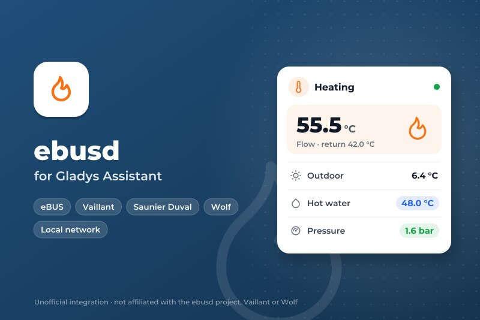
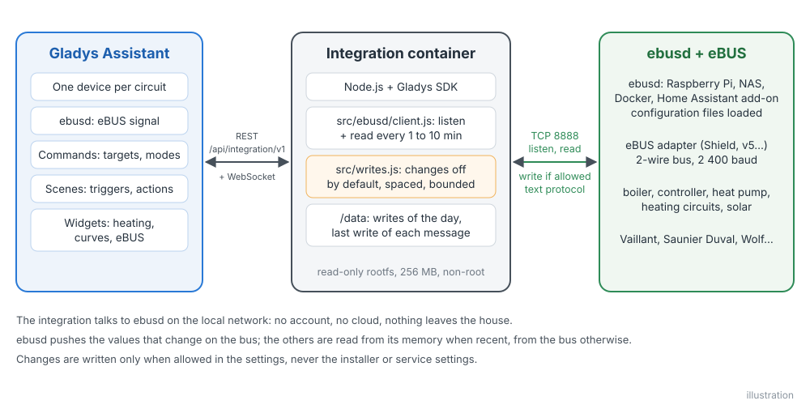
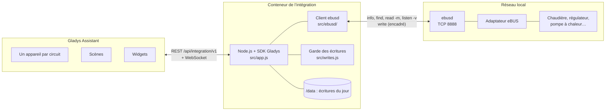
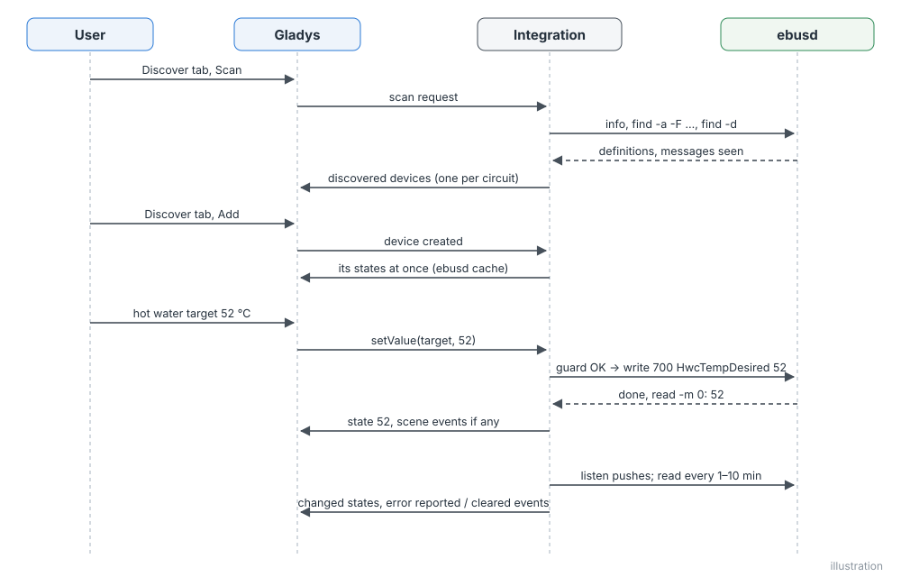
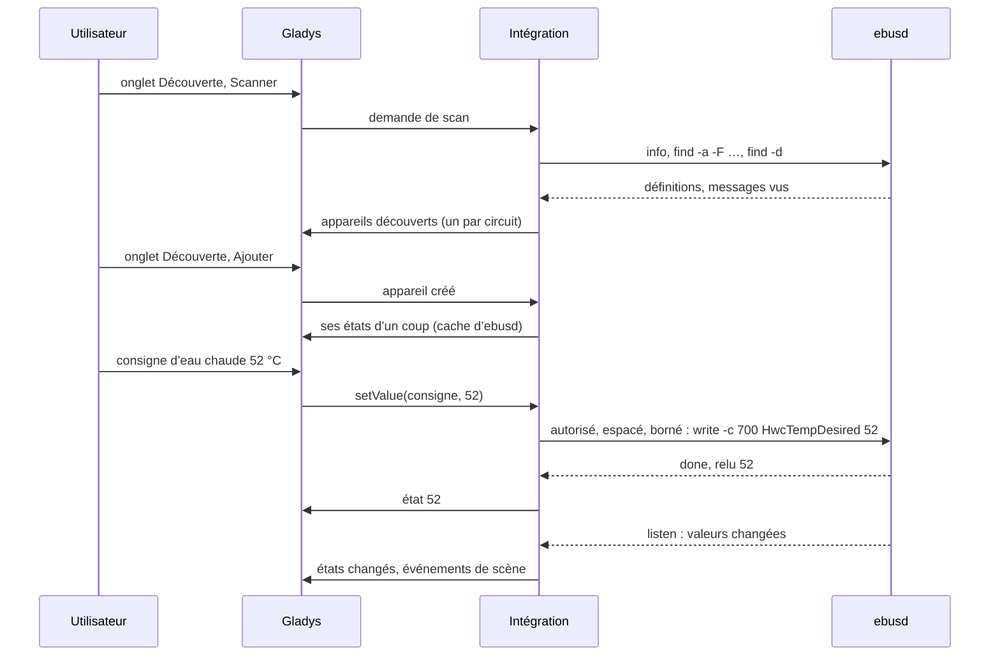
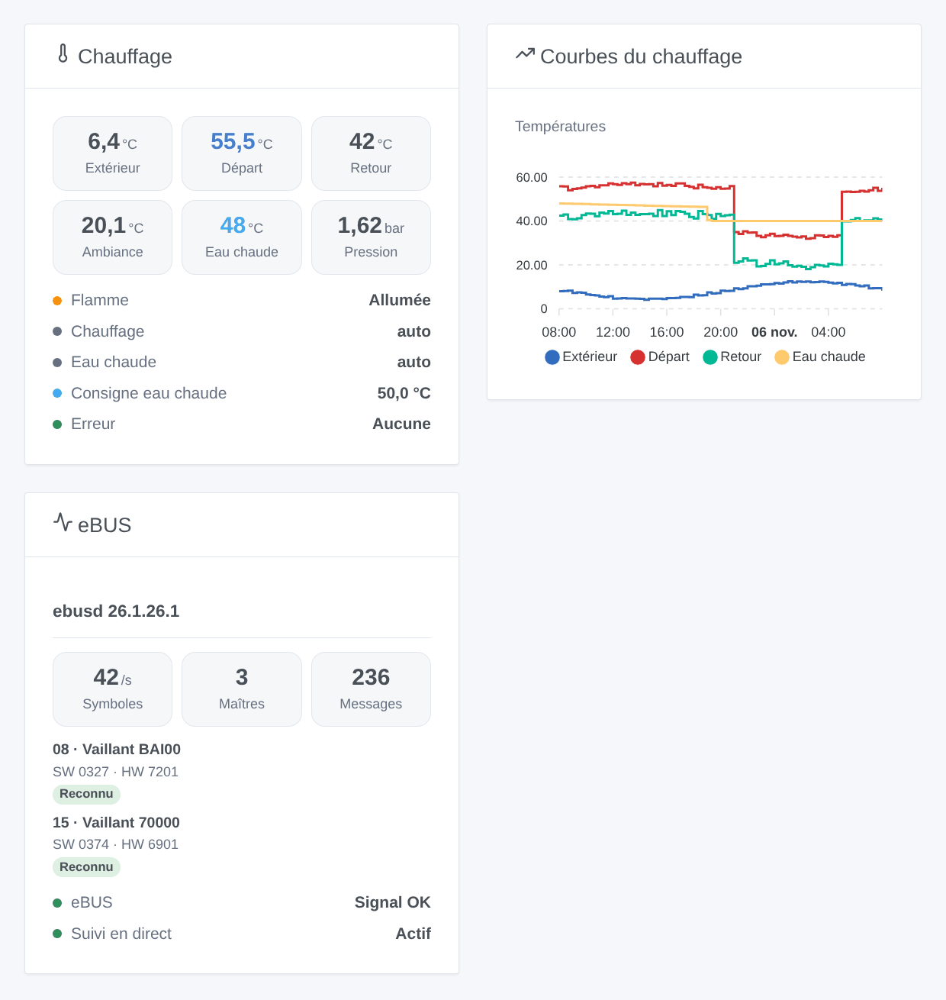
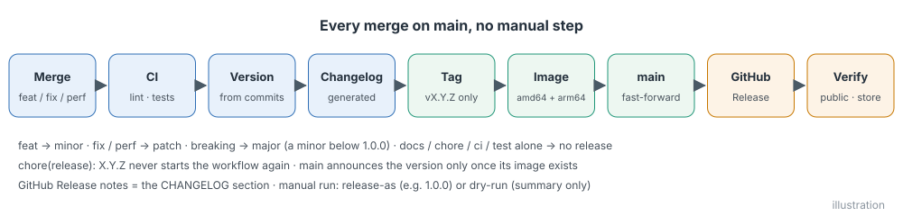

# ebusd pour Gladys Assistant

[English](README.md) | **Français** | [Deutsch](README.de.md) | [Español](README.es.md)

[](LICENSE)
[](https://github.com/William-De71/gladys-ebusd/releases)
[](https://github.com/William-De71/gladys-ebusd/actions/workflows/release.yml)
[](https://gladysassistant.com)



Votre chauffage eBUS (Vaillant, Saunier Duval, AWB, Bulex, Wolf, Kromschröder…) dans Gladys Assistant, via le programme libre [ebusd](https://github.com/john30/ebusd), sur votre réseau local. La chaudière, la pompe à chaleur et le régulateur deviennent des appareils Gladys, avec des valeurs en direct, trois widgets, des déclencheurs de scène et des modifications soigneusement encadrées. Non officielle, sans lien avec le projet ebusd ni les marques citées.

## Fonctionnalités

- **Dialogue avec ebusd sur le réseau local**, sur son port TCP (8888 par défaut), avec l’utilisateur et le secret facultatifs d’un fichier d’accès ebusd.
- **Un appareil Gladys par circuit eBUS** connu d’ebusd : la chaudière (`bai`), la pompe à chaleur (`hmu`), le régulateur (`700`, `720`, `ctlv2`…), les circuits de chauffage, les valeurs diffusées, nommés d’après le modèle qu’ils annoncent ; plus ebusd lui-même avec le signal eBUS.
- **Seulement les fonctionnalités utiles** : les valeurs qu’ebusd a vues sur le bus avec un nom utile (températures, pression, flamme, modulation, puissance, énergie, heures, démarrages, modes, erreur en cours) et les messages connus des installations Vaillant, ou toutes les valeurs qu’ebusd a vues, plus les messages que vous indiquez.
- **Valeurs en direct** : ebusd pousse chaque valeur qui change sur le bus ; les autres sont lues toutes les 1 à 10 minutes, dans la mémoire d’ebusd quand elle est assez récente, sur le bus sinon.
- **Modifications désactivées par défaut** : une fois autorisées, les consignes ambiantes, la consigne d’eau chaude, les marches/arrêts et les modes que le régulateur ouvre à tout le monde, dans des bornes fixes, jamais les réglages installateur ou SAV, espacées et comptées.
- **Trois widgets de tableau de bord** : le chauffage d’un coup d’œil, les courbes de températures, l’eBUS et ses appareils.
- **Quatre déclencheurs de scène** (erreur signalée, erreur disparue, ebusd perdu, ebusd revenu) et **deux actions de scène** (lire n’importe quel message, écrire un message).
- Anglais, français, allemand et espagnol.

## Fonctionnement





**Protocole.** ebusd répond à des commandes texte sur son port TCP, une ligne par requête, une ligne vide à la fin de chaque réponse. L’intégration utilise `info` (version, signal, les appareils vus et le fichier de configuration chargé pour chacun), `find -a -F …` (toutes les définitions de messages, avec leurs champs, unités et listes de valeurs), `find -d` (les messages qui ont des données), `read -m <secondes> -v` (une valeur prise dans le cache d’ebusd quand elle est assez récente, sur le bus sinon), `listen -v` (les valeurs poussées quand elles changent) et `write` (une modification, encadrée). Le port HTTP et le MQTT d’ebusd ne sont pas nécessaires.

**Découverte.** Chaque circuit d’ebusd devient un appareil. ebusd charge la configuration d’un appareil quelques minutes après l’avoir vu sur le bus : l’intégration regarde à nouveau toutes les 10 minutes pendant la première heure, puis toutes les heures, et propose les nouveaux appareils dans l’onglet Découverte.

**Écritures.** Voir [Configuration](#configuration). Une valeur est modifiable quand le régulateur a un message d’écriture correspondant ouvert à tout le monde (sans niveau d’accès « install » ou « service »), avec un seul champ : une consigne ambiante (5–30 °C), la consigne d’eau chaude (35–70 °C), une marche/arrêt ou une liste de modes nommés. Tout le reste est en lecture seule.





### Appareils et fonctionnalités

| Appareil Gladys                  | Fonctionnalités                                                                                                                                                                                                                                                                                          |
| -------------------------------- | -------------------------------------------------------------------------------------------------------------------------------------------------------------------------------------------------------------------------------------------------------------------------------------------------------- |
| `daemon:ebusd` — ebusd           | `signal` : l’adaptateur entend l’eBUS (marche / arrêt)                                                                                                                                                                                                                                                   |
| `circuit:<nom>` — un par circuit | une fonctionnalité par champ utile : températures (°C), pression (bar, mbar), modulation et humidité (%), puissance (W, kW), énergie (Wh, kWh, MWh), tension, courant, heures, minutes, secondes, démarrages, marche / arrêt (flamme, pompe…), valeurs nommées (modes, états), le code d’erreur en cours |
| modifiables, une fois autorisé   | consignes ambiantes (thermostat, 5–30 °C), consigne d’eau chaude (chauffe-eau, 35–70 °C), marches / arrêts et modes nommés (liste) que le régulateur ouvre à tout le monde                                                                                                                               |

Exemple avec une chaudière Vaillant et un VRC 700 : la chaudière `bai` (températures de départ, de retour, extérieure, d’eau chaude et du ballon, pression d’eau, flamme, modulation du brûleur, heures et démarrages chauffage et eau chaude, erreur en cours) et le régulateur `700` (températures extérieure et ambiante, consignes ambiantes jour / nuit, modes chauffage et eau chaude, consigne d’eau chaude). Identifiants externes : `ext:<sélecteur>:circuit:<circuit>`, fonctionnalités `…:<message>.<champ>`, en minuscules.

## Transport

`transports: ["local"]` : le catalogue affiche le badge **local**. Rien ne sort du réseau local : ni compte, ni cloud. Chaque appareil publie **local** tant qu’ebusd répond et **injoignable** sinon ; il n’y a ni préférence locale à choisir, ni mode dégradé.

## Widgets



- **Chauffage** : températures extérieure, de départ, de retour, ambiante et d’eau chaude, pression, modulation (les tuiles suivent en direct les états des appareils), puis flamme, modes chauffage et eau chaude, consigne d’eau chaude, erreur en cours, signal eBUS.
- **Courbes du chauffage** : températures extérieure, de départ, de retour et d’eau chaude sur 24 heures, 3 ou 7 jours (une fois les appareils ajoutés).
- **eBUS** : version d’ebusd, débit de symboles, maîtres, messages, les appareils vus sur le bus avec leur modèle, logiciel, matériel et s’ils sont reconnus par ebusd, le signal et le suivi en direct.

## Déclencheurs et actions de scène

| Déclencheur      | Quand                                                                           | Données                                                     |
| ---------------- | ------------------------------------------------------------------------------- | ----------------------------------------------------------- |
| `error_reported` | un appareil signale un code d’erreur qu’il ne signalait pas avant (F.28, F.75…) | `device`, `device_name`, `circuit`, `message`, `error_code` |
| `error_cleared`  | l’appareil ne le signale plus                                                   | idem                                                        |
| `ebusd_offline`  | ebusd ne répond pas pendant 3 minutes                                           | `address`                                                   |
| `ebusd_online`   | ebusd répond de nouveau                                                         | `address`                                                   |

| Action        | Ce qu’elle fait                                                                                           | Sorties                             |
| ------------- | --------------------------------------------------------------------------------------------------------- | ----------------------------------- |
| `read_value`  | lit n’importe quel message par circuit et nom (sur le bus quand la valeur d’ebusd est trop ancienne)      | `value`, `number`, `unit`, `fields` |
| `write_value` | écrit un message ouvert à tous, quand les modifications sont autorisées (espacé et compté comme le reste) | `result`                            |

Exemples :

- Quand la chaudière signale une erreur → envoyer un message avec `{{triggerEvent.data.error_code}}`.
- Quand ebusd ne répond plus → prévenir, la maison n’est peut-être plus chauffée.
- Chaque matin → lire `bai WaterPressure` ; sous 1 bar → rappeler de remettre en pression le chauffage.

## Prérequis

- Gladys Assistant **5.3.0 ou plus récent** (mots-clés du catalogue de Gladys 5.3, widgets de tableau de bord et déclencheurs et actions de scène des intégrations ; les instances plus anciennes ne peuvent pas installer l’intégration).
- [ebusd](https://github.com/john30/ebusd) en marche avec un adaptateur eBUS (par exemple l’eBUS Adapter Shield), ses fichiers de configuration (par défaut, `--scanconfig`) et son port TCP joignable depuis Gladys (pas lancé avec `--localhost`).

## Installation

- **Depuis le store** : Intégrations → chercher « ebusd » → Installer.
- **Depuis l’URL du dépôt** : Intégrations → Installer une intégration → coller `https://github.com/William-De71/gladys-ebusd`.
- **Mode développeur** : Intégrations → Installer une intégration → Mode développeur, avec le manifeste d’un build (le résumé du workflow « Build and publish image » l’affiche).

## Configuration

| Champ            | Type    | Défaut   | Signification                                                                                                        |
| ---------------- | ------- | -------- | -------------------------------------------------------------------------------------------------------------------- |
| `host`           | string  | vide     | adresse IP ou nom de la machine où tourne ebusd (pas `localhost`), `:port` accepté                                   |
| `port`           | number  | `8888`   | port TCP d’ebusd (`--port`)                                                                                          |
| `user`, `secret` | string  | vide     | seulement avec un fichier d’accès ebusd (`--aclfile`)                                                                |
| `poll_interval`  | select  | `120`    | secondes entre deux lectures : 60, 120, 300, 600                                                                     |
| `messages`       | select  | `useful` | `useful` : les valeurs utiles vues par ebusd et les messages connus ; `all` : toutes les valeurs vues                |
| `extra_messages` | string  | vide     | messages toujours proposés et lus, `circuit.Message`, séparés par des virgules (`bai.PumpPower`)                     |
| `allow_writes`   | boolean | `false`  | autoriser les modifications (consignes ambiantes et d’eau chaude, marche / arrêt, modes), avec les gardes ci-dessous |
| `language`       | select  | `en`     | langue des noms d’appareils et de fonctionnalités, des états texte et des erreurs de scène                           |

Gardes sur les modifications : une valeur déjà en place n’est jamais réécrite ; un même message au plus une fois par minute ; 100 modifications par jour (comptées dans `/data/writes.json`) ; bornes : ambiance 5–30 °C, eau chaude 35–70 °C, pas de 0,5 °C ; jamais un message avec un niveau d’accès ; la valeur est relue.

Bouton de la page de configuration : **Tester ebusd et chercher les appareils** (se connecte, vérifie le signal, liste les appareils trouvés avec leur nombre de valeurs).

## Utilisation

1. Lancez ebusd avec votre adaptateur ; vérifiez avec `ebusctl info` qu’il voit vos appareils et a chargé leur configuration.
2. Installez l’intégration, saisissez l’adresse d’ebusd, puis appuyez sur **Tester ebusd et chercher les appareils**.
3. Ajoutez les appareils depuis l’onglet **Découverte**, les widgets à un tableau de bord, créez vos scènes. N’autorisez les modifications que si vous en avez besoin.

La documentation utilisateur est dans [docs/fr.md](docs/fr.md) ([en](docs/en.md), [de](docs/de.md), [es](docs/es.md)).

## Limites

- **Jamais testée sur un vrai eBUS** : tout est testé contre les réponses d’un vrai ebusd 26.1 (image Docker officielle, chaudière Vaillant BAI00 et VRC 700 annoncés sur un bus simulé) rejouées par un faux ebusd sur une vraie socket locale. Les retours sont bienvenus, avec votre `ebusctl info`.
- Les noms des fonctionnalités viennent d’ebusd (`Flow temp desired`), sauf pour les messages connus, traduits.
- Les valeurs sans catégorie Gladys (dates, heures, débits en l/min, nombres bruts sans unité) ne sont pas proposées ; l’action de scène `read_value` les lit.
- Modifiables : consignes ambiantes et d’eau chaude, marche / arrêt et modes seulement ; ni plannings, ni courbe de chauffe, ni dates de vacances.

## Développement local

```bash
npm install
GLADYS_HOST_API_URL=http://localhost:1443 \
  GLADYS_INTEGRATION_TOKEN=… GLADYS_INTEGRATION_SELECTOR=… \
  EBUSD_DATA_DIR=./data DEBUG=gladys-integration-sdk node index.js
```

Un vrai ebusd sans adaptateur, pour essayer (les réponses du scan sont injectées) :

```bash
docker run -d --name ebusd-lab -p 18888:8888 john30/ebusd:latest -f \
  --device=enh:127.0.0.1:9999 --nodevicecheck --scanconfig --accesslevel='*' \
  --inject FF08070400/0AB5424149303003277201
```

| Variable                                                                         | Défaut          | Usage                                         |
| -------------------------------------------------------------------------------- | --------------- | --------------------------------------------- |
| `GLADYS_HOST_API_URL`, `GLADYS_INTEGRATION_TOKEN`, `GLADYS_INTEGRATION_SELECTOR` | fixé par Gladys | connexion à l’API hôte de Gladys              |
| `EBUSD_DATA_DIR`                                                                 | `/data`         | dossier de `writes.json`                      |
| `DEBUG`                                                                          | non défini      | `gladys-integration-sdk` pour les logs du SDK |

| Script                            | Ce qu’il fait                                        |
| --------------------------------- | ---------------------------------------------------- |
| `npm test`                        | les tests (`node --test`), rien ne sort de 127.0.0.1 |
| `npm run lint`                    | ESLint                                               |
| `npm run format` / `format:check` | Prettier                                             |
| `docs/illustrations/render.sh`    | regénère les illustrations des widgets               |
| `scripts/build-cover.sh`          | regénère `cover.jpg` depuis `docs/assets/cover.svg`  |

## Tests

`npm test` fait tourner toute l’intégration contre le faux Gladys du SDK et un faux ebusd sur une vraie socket locale, alimenté par les vraies réponses d’ebusd 26.1 (`test/fixtures`). Couvert : le protocole (réponses, erreurs, CSV entre guillemets, lignes de valeurs de `read`, `find` et `listen`, `info`), le catalogue (messages utiles, jamais ceux d’installateur ou de SAV, catégories et unités Gladys, consignes modifiables et leurs bornes), le client (une commande à la fois, délais, reconnexion, authentification, écoute rétablie avec ebusd), la découverte, les valeurs du cache et en direct, les lectures, les écritures et chaque garde (interrupteur, bornes, même valeur, espacement, quota du jour conservé aux redémarrages), les déclencheurs et actions de scène, les trois widgets validés par `validateWidgetContent`, ebusd perdu et revenu, les réglages. Une référence de découverte fige les identifiants externes et les champs Gladys ; le manifeste est vérifié contre le code, les traductions et le script de release. La CI construit aussi l’image et la lance comme Gladys (lecture seule, 256 Mo, sans réseau).

## Processus de release

Chaque fusion sur `main` publie une release quand ses commits le justifient, sans aucune étape manuelle :

```mermaid
flowchart LR
  A[fusion sur main] --> B[CI : Prettier, ESLint,<br/>tests, build Docker]
  B --> C[version suivante d’après<br/>les Conventional Commits]
  C --> D[section du CHANGELOG.md]
  D --> E[commit chore release<br/>+ tag vX.Y.Z]
  E --> F[image :X.Y.Z + :latest<br/>amd64 + arm64]
  F --> G[main avance sur<br/>le commit de release]
  G --> H[GitHub Release]
  H --> I[vérif : pull anonyme,<br/>validateur du store, topic]
```





- `feat` → mineure, `fix` / `perf` → corrective, `!` ou `BREAKING CHANGE:` → majeure (une mineure tant qu’on est sous 1.0.0). `docs`, `chore`, `ci`, `test`, `style`, `refactor`, `build` seuls ne publient rien.
- Le titre de la pull request devient le commit squash, donc la ligne du changelog : écrivez-le en anglais, pour l’utilisateur (`feat(widgets): …`). `pr-title.yml` le vérifie. Ne modifiez jamais `CHANGELOG.md` à la main.
- L’image existe avant que `main` annonce sa version (le store indexe `main`).
- La 1.0.0 est une décision manuelle : Actions → Release → Run workflow, `release-as: 1.0.0`. `dry-run` affiche la version et le changelog sans rien publier.
- **`main` protégée** : la release pousse un commit sur `main`. Avec une protection de branche ou un ruleset qui exige des pull requests ou des status checks, autorisez GitHub Actions à les contourner (ou utilisez une GitHub App), sinon la release s’arrête après l’image.
- Après la première release, rendez le package public si besoin : Package settings → Change visibility → Public.

## Dépannage

- **« ebusd ne répond pas »** : vérifiez l’adresse et le port ; ebusd doit écouter sur le réseau (pas `--localhost`) ; `localhost` ne fonctionne pas depuis le conteneur de l’intégration ; un pare-feu peut bloquer le port 8888.
- **« n’entend rien sur l’eBUS »** : ebusd tourne mais l’adaptateur n’a pas de signal : vérifiez l’adaptateur, son câblage et `ebusctl state`.
- **Un appareil manque** : ebusd n’a pas encore chargé sa configuration (`ebusctl info` : pas de partie `loaded`) ; attendez quelques minutes ou relancez la recherche.
- **Une valeur manque** : choisissez « Toutes celles qu’ebusd a vues », ou indiquez le message dans « Messages en plus ».
- **« Les modifications sont désactivées »** : cochez **Autoriser les modifications**. **« réessayez dans … s »** : le même message a été modifié il y a moins d’une minute.
- **« a refusé le nom d’utilisateur ou le secret »** : vérifiez le fichier d’accès d’ebusd.
- Journaux : l’onglet Journaux de l’intégration ; `DEBUG=gladys-integration-sdk` pour le détail du SDK.

## Contribuer

Les issues et pull requests sont bienvenues. Lancez `npm run format:check`, `npm run lint` et `npm test`, écrivez le titre de la pull request en Conventional Commit, et relancez `docs/illustrations/render.sh` après toute modification d’un contenu de widget. Une nouvelle fonctionnalité ne doit pas changer les existantes (`test/fixtures/discovery.baseline.json`). Quand une vraie installation se comporte autrement, ajoutez d’abord ses réponses `ebusctl info` et `find` à `test/fixtures`, puis corrigez le code.

## Sécurité

Voir [SECURITY.md](SECURITY.md). Le secret ebusd facultatif est un réglage secret de Gladys, jamais journalisé. ebusd n’a pas d’authentification sauf s’il est lancé avec un fichier d’accès : gardez-le sur un réseau de confiance, jamais exposé à Internet. `/data` ne garde que les écritures du jour. Les modifications sont désactivées par défaut.

## Licence

[Licence Apache 2.0](LICENSE), voir aussi [NOTICE](NOTICE). Le client a été écrit pour ce projet à partir de la documentation des commandes TCP d’ebusd ; aucun code d’ebusd (GPL-3.0) n’a été copié ; les données de test citent des données de configuration d’ebusd sous GPL-3.0 (`test/fixtures/README.md`). ebusd est un projet de John Baier ; Vaillant, Saunier Duval, Wolf et les autres marques appartiennent à leurs propriétaires ; ce projet n’est ni affilié, ni approuvé, ni soutenu par eux.
