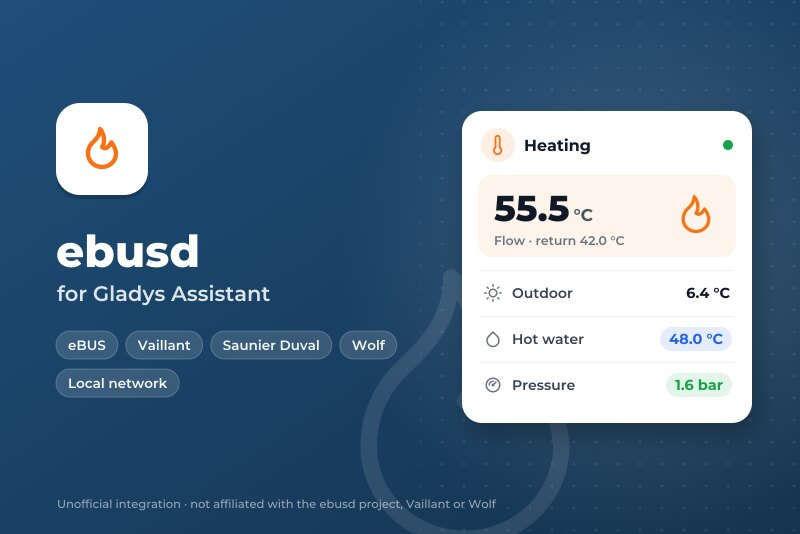
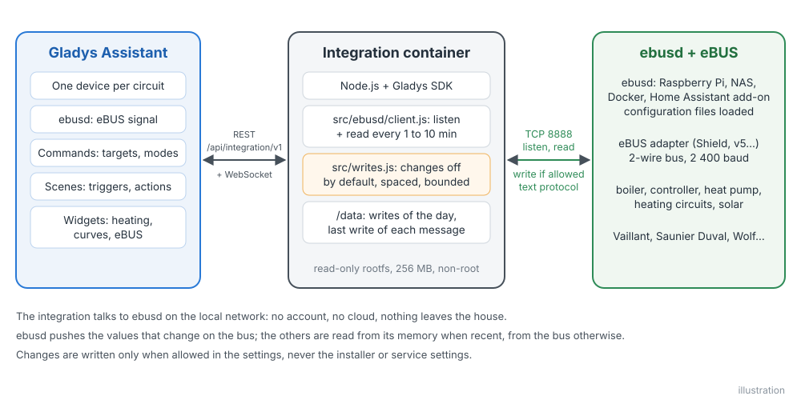
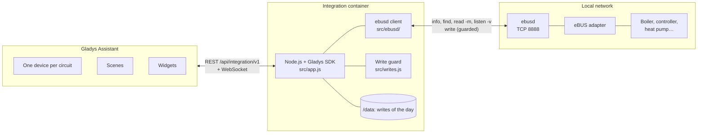
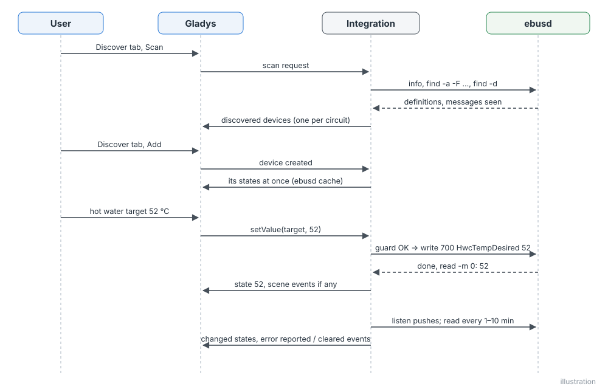
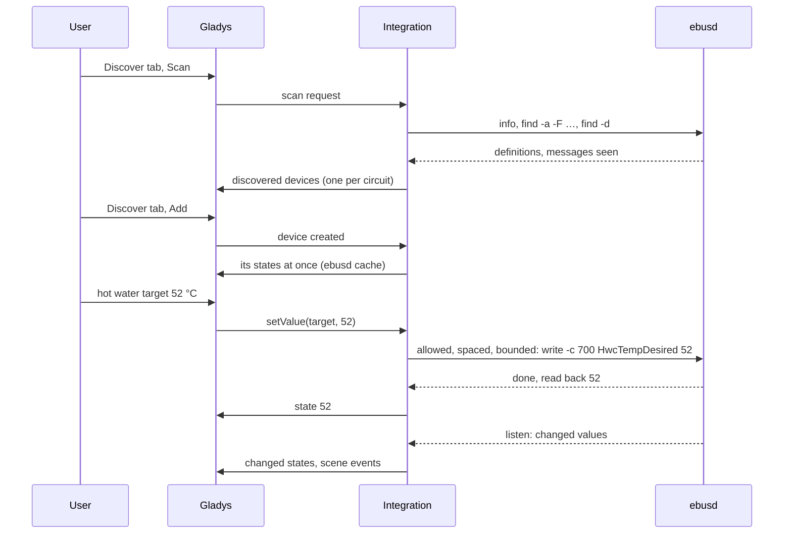
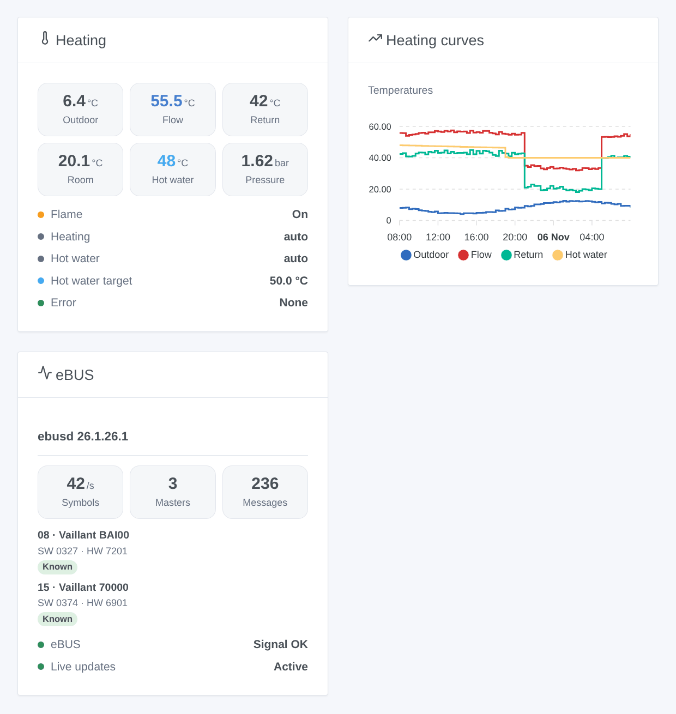
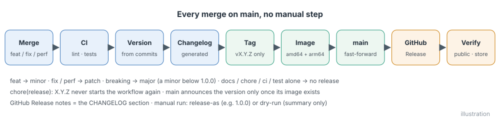

# ebusd for Gladys Assistant

**English** | [Français](README.fr.md) | [Deutsch](README.de.md) | [Español](README.es.md)

[](LICENSE)
[](https://github.com/William-De71/gladys-ebusd/releases)
[](https://github.com/William-De71/gladys-ebusd/actions/workflows/release.yml)
[](https://gladysassistant.com)



Your eBUS heating (Vaillant, Saunier Duval, AWB, Bulex, Wolf, Kromschröder…) in Gladys Assistant, through the free [ebusd](https://github.com/john30/ebusd) daemon, on your local network. The boiler, the heat pump and the controller become Gladys devices, with live values, three widgets, scene triggers and carefully guarded changes. Unofficial, not affiliated with the ebusd project or the brands above.

## Features

- **Talks to ebusd over the local network**, on its TCP port (8888 by default), with the optional user and secret of an ebusd access file.
- **One Gladys device per eBUS circuit** ebusd knows: the boiler (`bai`), the heat pump (`hmu`), the controller (`700`, `720`, `ctlv2`…), the heating circuits, the broadcast values, named after the model they announce; plus ebusd itself with the eBUS signal.
- **Useful features only**: the values ebusd has seen on the bus with a useful name (temperatures, pressure, flame, modulation, power, energy, hours, starts, modes, current error) and the well-known messages of Vaillant installations, or every value ebusd has seen, plus any message you list.
- **Live values**: ebusd pushes every value that changes on the bus; the others are read every 1 to 10 minutes, from the memory of ebusd when recent enough, from the bus otherwise.
- **Changes off by default**: once allowed, room targets, hot water target, on/off and operating modes that the controller opens to everyone, within fixed bounds, never the installer or service settings, spaced and counted.
- **Three dashboard widgets**: heating at a glance, temperature curves, the eBUS and its devices.
- **Four scene triggers** (error reported, error cleared, ebusd lost, ebusd back) and **two scene actions** (read any message, write a message).
- English, French, German and Spanish.

## How it works





**Protocol.** ebusd answers text commands on its TCP port, one line per request, an empty line at the end of each answer. The integration uses `info` (version, signal, the devices seen and the configuration file loaded for each), `find -a -F …` (every message definition, with its fields, units and value lists), `find -d` (the messages that have data), `read -m <seconds> -v` (a value from the cache of ebusd when recent enough, from the bus otherwise), `listen -v` (the values pushed as they change) and `write` (a change, guarded). The HTTP port and MQTT of ebusd are not needed.

**Discovery.** Each circuit of ebusd becomes a device. ebusd loads the configuration of a device a few minutes after it sees it on the bus: the integration looks again every 10 minutes during the first hour, then every hour, and offers the new devices in the Discover tab.

**Writes.** See [Configuration](#configuration). A value is writable when the controller has a matching write message open to everyone (no "install" or "service" access level), with a single field: a room target (5–30 °C), the hot water target (35–70 °C), an on/off or a list of named modes. Everything else is read only.





### Devices and features

| Gladys device                      | Features                                                                                                                                                                                                                                                                   |
| ---------------------------------- | -------------------------------------------------------------------------------------------------------------------------------------------------------------------------------------------------------------------------------------------------------------------------- |
| `daemon:ebusd` — ebusd             | `signal`: the adapter hears the eBUS (on / off)                                                                                                                                                                                                                            |
| `circuit:<name>` — one per circuit | one feature per useful field: temperatures (°C), pressure (bar, mbar), modulation and humidity (%), power (W, kW), energy (Wh, kWh, MWh), voltage, current, hours, minutes, seconds, starts, on / off (flame, pump…), named values (modes, states), the current error code |
| writable, once changes are allowed | room targets (thermostat, 5–30 °C), hot water target (water heater, 35–70 °C), on / off and named modes (select) that the controller opens to everyone                                                                                                                     |

Example with a Vaillant boiler and a VRC 700: the boiler `bai` (flow, return, outdoor, hot water and tank temperatures, water pressure, flame, burner modulation, heating and hot water hours and starts, current error) and the controller `700` (outdoor and room temperatures, room day / night targets, heating and hot water modes, hot water target). External ids: `ext:<selector>:circuit:<circuit>`, features `…:<message>.<field>`, in lower case.

## Transport

`transports: ["local"]`: the catalogue shows the **local** badge. Nothing leaves the local network: no account, no cloud. Each device publishes **local** while ebusd answers and **unreachable** otherwise; there is no local preference to choose, nor degraded mode.

## Widgets



- **Heating**: outdoor, flow, return, room and hot water temperatures, pressure, modulation (the tiles follow the device states live), then flame, heating and hot water modes, hot water target, current error, eBUS signal.
- **Heating curves**: outdoor, flow, return and hot water temperatures over 24 hours, 3 or 7 days (once the devices are added).
- **eBUS**: ebusd version, symbol rate, masters, messages, the devices seen on the bus with their model, software, hardware and whether ebusd knows them, the signal and the live updates.

## Scene triggers and actions

| Trigger          | When                                                                  | Data                                                        |
| ---------------- | --------------------------------------------------------------------- | ----------------------------------------------------------- |
| `error_reported` | a device reports an error code it did not report before (F.28, F.75…) | `device`, `device_name`, `circuit`, `message`, `error_code` |
| `error_cleared`  | the device no longer reports it                                       | same                                                        |
| `ebusd_offline`  | ebusd does not answer for 3 minutes                                   | `address`                                                   |
| `ebusd_online`   | ebusd answers again                                                   | `address`                                                   |

| Action        | What it does                                                                                   | Outputs                             |
| ------------- | ---------------------------------------------------------------------------------------------- | ----------------------------------- |
| `read_value`  | reads any message by circuit and name (from the bus when the value of ebusd is too old)        | `value`, `number`, `unit`, `fields` |
| `write_value` | writes a message open to everyone, when changes are allowed (spaced and counted like the rest) | `result`                            |

Examples:

- When the boiler reports an error → send a message with `{{triggerEvent.data.error_code}}`.
- When ebusd stops answering → notify, the house may not be heated.
- Every morning → read `bai WaterPressure`; if below 1 bar → remind to top up the heating.

## Requirements

- Gladys Assistant **5.3.0 or later** (catalog keywords of Gladys 5.3, dashboard widgets and scene triggers and actions of integrations; older instances cannot install the integration).
- [ebusd](https://github.com/john30/ebusd) running with an eBUS adapter (for example the eBUS Adapter Shield), its configuration files (the default, `--scanconfig`) and its TCP port reachable from Gladys (not started with `--localhost`).

## Installation

- **From the store**: Integrations → search "ebusd" → Install.
- **From the repository URL**: Integrations → Install an integration → paste `https://github.com/William-De71/gladys-ebusd`.
- **Developer mode**: Integrations → Install an integration → Developer mode, with the manifest of a build (the summary of the "Build and publish image" workflow prints it).

## Configuration

| Field            | Type    | Default  | Meaning                                                                                     |
| ---------------- | ------- | -------- | ------------------------------------------------------------------------------------------- |
| `host`           | string  | empty    | IP address or name of the machine running ebusd (not `localhost`), `:port` accepted         |
| `port`           | number  | `8888`   | TCP port of ebusd (`--port`)                                                                |
| `user`, `secret` | string  | empty    | only with an ebusd access file (`--aclfile`)                                                |
| `poll_interval`  | select  | `120`    | seconds between two readings: 60, 120, 300, 600                                             |
| `messages`       | select  | `useful` | `useful`: the useful values ebusd has seen and the well-known ones; `all`: every value seen |
| `extra_messages` | string  | empty    | messages always offered and read, `circuit.Message`, with commas (`bai.PumpPower`)          |
| `allow_writes`   | boolean | `false`  | allow changes (room and hot water targets, on / off, modes), with the guards below          |
| `language`       | select  | `en`     | language of the device and feature names, of the text states and of the scene errors        |

Guards on changes: a value already set is never written; one message at most once a minute; 100 changes a day (counted in `/data/writes.json`); bounds: room 5–30 °C, hot water 35–70 °C, steps of 0.5 °C; never a message with an access level; the value is read back.

Button of the configuration page: **Test ebusd and search the devices** (connects, checks the signal, lists the devices found with their number of values).

## Usage

1. Run ebusd with your adapter; check with `ebusctl info` that it sees your devices and loaded their configuration.
2. Install the integration, type the address of ebusd, then press **Test ebusd and search the devices**.
3. Add the devices from the **Discover** tab, the widgets to a dashboard, create your scenes. Allow changes only if you need them.

The user documentation is in [docs/en.md](docs/en.md) ([fr](docs/fr.md), [de](docs/de.md), [es](docs/es.md)).

## Limits

- **Never tested on a real eBUS**: everything is tested against the answers of a real ebusd 26.1 (official Docker image, Vaillant BAI00 boiler and VRC 700 announced on an injected bus) replayed by a fake ebusd on a real local socket. Feedback welcome, with your `ebusctl info`.
- The names of features come from ebusd (`Flow temp desired`) except for the well-known messages, translated.
- Values without a Gladys category (dates, times, flow rates in l/min, raw numbers without unit) are not offered; the `read_value` scene action reads them.
- Writable: room and hot water targets, on / off and modes only; no schedules, no heating curve, no holiday dates.

## Local development

```bash
npm install
GLADYS_HOST_API_URL=http://localhost:1443 \
  GLADYS_INTEGRATION_TOKEN=… GLADYS_INTEGRATION_SELECTOR=… \
  EBUSD_DATA_DIR=./data DEBUG=gladys-integration-sdk node index.js
```

A real ebusd without adapter, for trying (the scan answers are injected):

```bash
docker run -d --name ebusd-lab -p 18888:8888 john30/ebusd:latest -f \
  --device=enh:127.0.0.1:9999 --nodevicecheck --scanconfig --accesslevel='*' \
  --inject FF08070400/0AB5424149303003277201
```

| Variable                                                                         | Default       | Use                                       |
| -------------------------------------------------------------------------------- | ------------- | ----------------------------------------- |
| `GLADYS_HOST_API_URL`, `GLADYS_INTEGRATION_TOKEN`, `GLADYS_INTEGRATION_SELECTOR` | set by Gladys | connection to the Gladys host API         |
| `EBUSD_DATA_DIR`                                                                 | `/data`       | folder of `writes.json`                   |
| `DEBUG`                                                                          | unset         | `gladys-integration-sdk` for the SDK logs |

| Script                            | What it does                                        |
| --------------------------------- | --------------------------------------------------- |
| `npm test`                        | the tests (`node --test`), nothing leaves 127.0.0.1 |
| `npm run lint`                    | ESLint                                              |
| `npm run format` / `format:check` | Prettier                                            |
| `docs/illustrations/render.sh`    | regenerate the widget illustrations                 |
| `scripts/build-cover.sh`          | regenerate `cover.jpg` from `docs/assets/cover.svg` |

## Tests

`npm test` runs the whole integration against the fake Gladys of the SDK and a fake ebusd on a real local socket, fed with the real answers of ebusd 26.1 (`test/fixtures`). Covered: the protocol (answers, errors, quoted CSV, value lines of `read`, `find` and `listen`, `info`), the catalog (useful messages, never install / service ones, Gladys categories and units, writable targets and their bounds), the client (one command at a time, timeouts, reconnection, authentication, listener restarted with ebusd), discovery, cached and live values, readings, writes and every guard (switch, bounds, same value, spacing, daily quota kept across restarts), scene triggers and actions, the three widgets validated by `validateWidgetContent`, ebusd lost and back, settings. A discovery baseline pins the external ids and the Gladys fields; the manifest is checked against the code, the translations and the release script. The CI also builds the image and starts it like Gladys does (read-only, 256 MB, no network).

## Release process

Every merge on `main` publishes a release when its commits deserve one, with no manual step:

```mermaid
flowchart LR
  A[merge on main] --> B[CI: Prettier, ESLint,<br/>tests, Docker build]
  B --> C[next version from<br/>Conventional Commits]
  C --> D[CHANGELOG.md section]
  D --> E[commit chore release<br/>+ tag vX.Y.Z]
  E --> F[image :X.Y.Z + :latest<br/>amd64 + arm64]
  F --> G[main moves to<br/>the release commit]
  G --> H[GitHub Release]
  H --> I[verify: anonymous pull,<br/>store validator, topic]
```





- `feat` → minor, `fix` / `perf` → patch, `!` or `BREAKING CHANGE:` → major (a minor below 1.0.0). `docs`, `chore`, `ci`, `test`, `style`, `refactor`, `build` alone publish nothing.
- The pull request title becomes the squash commit, hence the changelog line: write it in English, for the user (`feat(widgets): …`). `pr-title.yml` checks it. Never edit `CHANGELOG.md` by hand.
- The image exists before `main` announces its version (the store indexes `main`).
- 1.0.0 is a manual decision: Actions → Release → Run workflow, `release-as: 1.0.0`. `dry-run` shows the version and the changelog without publishing.
- **Protected `main`**: the release pushes a commit to `main`. With a branch protection or a ruleset requiring pull requests or status checks, allow GitHub Actions to bypass it (or use a GitHub App), otherwise the release stops after the image.
- After the first release, make the package public if needed: Package settings → Change visibility → Public.

## Troubleshooting

- **"ebusd does not answer"**: check the address and the port; ebusd must listen on the network (not `--localhost`); `localhost` does not work from the integration container; a firewall may block port 8888.
- **"hears nothing on the eBUS"**: ebusd runs but the adapter has no signal: check the adapter, its wiring and `ebusctl state`.
- **A device is missing**: ebusd has not loaded its configuration yet (`ebusctl info`: no `loaded` part); wait a few minutes or search again.
- **A value is missing**: choose "every value ebusd has seen", or list the message in "Extra messages".
- **"Changes are disabled"**: tick **Allow changes**. **"try again in … s"**: the same message was changed less than a minute ago.
- **"refused the user name or the secret"**: check the access file of ebusd.
- Logs: the Logs tab of the integration; `DEBUG=gladys-integration-sdk` for the SDK details.

## Contributing

Issues and pull requests are welcome. Run `npm run format:check`, `npm run lint` and `npm test`, write the pull request title as a Conventional Commit, and run `docs/illustrations/render.sh` after any change to a widget content. A new feature must not change the existing ones (`test/fixtures/discovery.baseline.json`). When a real installation behaves differently, add its `ebusctl info` and `find` answers to `test/fixtures` first, then fix the code.

## Security

See [SECURITY.md](SECURITY.md). The optional ebusd secret is a secret setting of Gladys, never logged. ebusd has no authentication unless started with an access file: keep it on a trusted network, never exposed to the Internet. `/data` keeps the writes of the day only. Changes are off by default.

## License

[Apache License 2.0](LICENSE), see also [NOTICE](NOTICE). The client was written for this project from the documentation of the ebusd TCP commands; no code of ebusd (GPL-3.0) was copied; the test fixtures quote ebusd configuration data under GPL-3.0 (`test/fixtures/README.md`). ebusd is a project of John Baier; Vaillant, Saunier Duval, Wolf and the other brands are trademarks of their owners; this project is not affiliated with, endorsed or supported by them.
