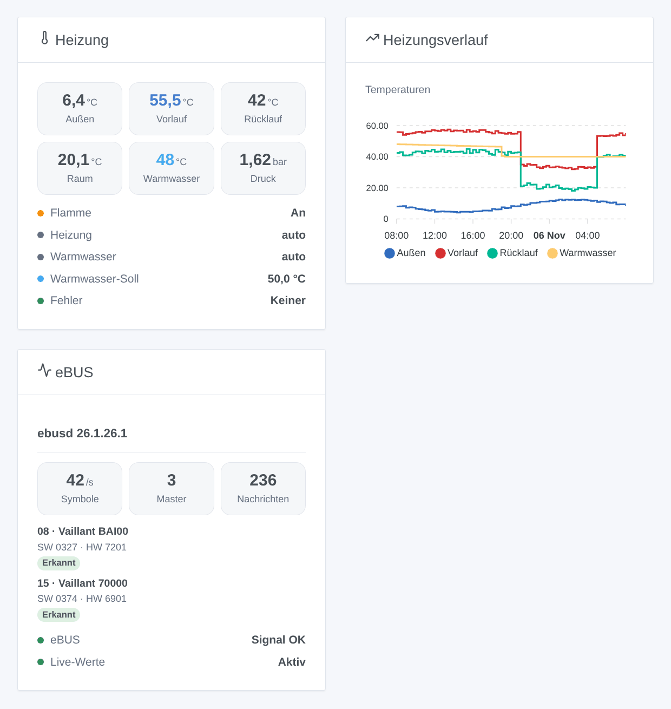

# ebusd

## Überblick

Diese Integration bringt Ihre eBUS-Heizung in Gladys: Vaillant, Saunier Duval, AWB, Bulex, Wolf, Kromschröder und die anderen Marken, deren Heizkessel, Wärmepumpen und Regler über den eBUS kommunizieren. Sie nutzt dafür [ebusd](https://github.com/john30/ebusd), ein freies Programm, das mit einem eBUS-Adapter den Bus mithört und die Nachrichten jedes Geräts kennt.

Jedes eBUS-Gerät, das ebusd kennt, wird zu einem Gladys-Gerät: der Heizkessel, die Wärmepumpe, der Regler, die Heizkreise, dazu ebusd selbst mit dem eBUS-Signal. Werte, die sich auf dem Bus ändern, kommen live an; die übrigen werden alle paar Minuten gelesen. Alles bleibt in Ihrem lokalen Netzwerk.

Inoffizielle Integration, weder mit dem ebusd-Projekt noch mit den genannten Marken verbunden.

## Voraussetzungen

- Gladys Assistant 5.3.0 oder neuer.
- ebusd läuft auf einem Raspberry Pi, einem NAS, dem Gladys-Rechner (Docker-Image `john30/ebusd`) oder als Home-Assistant-Add-on, mit einem eBUS-Adapter (zum Beispiel dem eBUS Adapter Shield).
- ebusd mit seinen Konfigurationsdateien (Standard) und mit von Gladys erreichbarem TCP-Port 8888: Starten Sie es nicht mit `--localhost`. Prüfen Sie mit `ebusctl info`, dass es Ihre Geräte sieht und für jedes eine geladene Konfiguration (`loaded`) anzeigt.

## Konfiguration

### ebusd

- **Adresse von ebusd**: die IP-Adresse oder der Name des Rechners, auf dem ebusd läuft. `localhost` funktioniert nicht: Gladys führt die Integration in einem eigenen Container aus.
- **TCP-Port**: 8888, sofern Sie `--port` nicht geändert haben.
- **Benutzer** und **Geheimnis**: nur, wenn ebusd eine Zugriffsdatei (`--aclfile`) verwendet.
- **Leseintervall**: 1 bis 10 Minuten (standardmäßig 2). Der eBUS ist langsam und wird mit Ihrer Heizung geteilt; Werte, die sich ändern, kommen ohnehin live an.
- **Angebotene Werte**: die nützlichen (Temperaturen, Druck, Flamme, Modulation, Leistung, Energie, Stunden, Starts, Betriebsarten, Fehler) oder alle, die ebusd gesehen hat.
- **Zusätzliche Nachrichten**: Nachrichten, die immer angeboten und gelesen werden, so benannt wie bei ebusd (`ebusctl find`), zum Beispiel `bai.PumpPower, 700.Z1NightTemp`.
- **Sprache der Namen und Texte**: die Sprache der Geräte- und Funktionsnamen und der Fehlermeldungen.

Drücken Sie **ebusd testen und Geräte suchen**: Die Antwort nennt die ebusd-Version, das eBUS-Signal und die gefundenen Geräte mit ihrer Anzahl an Werten.

### Einstellungen ändern

Standardmäßig aus: Gladys liest nur. Aktivieren Sie **Änderungen erlauben**, damit Gladys ändern kann, was der Regler für jeden freigibt:

- Raum-Solltemperaturen (Tag, Nacht…): 5 bis 30 °C;
- Warmwasser-Soll: 35 bis 70 °C;
- Ein/Aus und Betriebsarten (Heizung, Warmwasser: aus, Automatik, Tag, Nacht…).

Nie die Installateur- oder Service-Einstellungen. Derselbe Wert wird nie zweimal geschrieben, dieselbe Nachricht höchstens einmal pro Minute, höchstens 100 Änderungen pro Tag; nach dem Schreiben wird der Wert zurückgelesen.

## Verwendung

### Geräte

Fügen Sie unter **Integrationen → ebusd → Entdecken** die gewünschten Geräte hinzu:

- **ebusd**: das eBUS-Signal (ein, wenn der Adapter den Bus hört);
- ein Gerät pro eBUS-Kreis, benannt nach Art und Modell, zum Beispiel **Heizkessel bai (Vaillant BAI00)** oder **Regler 700 (Vaillant 70000)**.

Ihre Funktionen sind die nützlichen Werte: Vorlauf-, Rücklauf-, Außen-, Raum-, Warmwasser- und Speichertemperatur, Wasserdruck, Flamme, Modulation, Betriebsstunden und Starts, Betriebsarten Heizung und Warmwasser, aktueller Fehler… Ein neues Gerät erscheint einige Minuten, nachdem ebusd seine Konfiguration geladen hat: Drücken Sie dann erneut **Scannen**.

### Widgets

- **Heizung**: die wichtigsten Temperaturen, Druck und Modulation live, dann Flamme, Betriebsarten, Warmwasser-Soll und aktueller Fehler.
- **Heizungsverlauf**: Außen-, Vorlauf-, Rücklauf- und Warmwassertemperatur über 24 Stunden, 3 oder 7 Tage.
- **eBUS**: ebusd, der Verkehr auf dem Bus und die gesehenen Geräte mit Modell und Software.

### Szenen

Auslöser: **Ein eBUS-Gerät meldet einen Fehler** (mit dem Fehlercode), **Ein eBUS-Fehler ist behoben**, **ebusd antwortet nicht mehr**, **ebusd antwortet wieder**.

Aktionen: **eBUS-Wert lesen** (eine beliebige Nachricht über Kreis und Namen: Wert, Zahl, Einheit, alle Felder) und **eBUS-Wert schreiben** (eine für jeden offene Nachricht, wenn Änderungen erlaubt sind).

Beispiele:

- Wenn der Heizkessel einen Fehler meldet, eine Nachricht mit dem Fehlercode senden.
- Wenn ebusd nicht mehr antwortet, benachrichtigen: Das Haus wird womöglich nicht mehr geheizt.
- Jeden Morgen `bai WaterPressure` lesen; unter 1 bar daran erinnern, Wasser in der Heizung nachzufüllen.

## Fehlerbehebung

- **ebusd antwortet nicht**: Prüfen Sie Adresse und Port, dass ebusd im Netzwerk lauscht (nicht `--localhost`) und dass keine Firewall Port 8888 blockiert.
- **Kein eBUS-Signal**: ebusd läuft, aber der Adapter hört nichts; prüfen Sie den Adapter, seine Verkabelung und `ebusctl state`.
- **Ein Gerät oder ein Wert fehlt**: Warten Sie, bis ebusd die Konfiguration des Geräts geladen hat (`ebusctl info`), und suchen Sie dann erneut; wählen Sie „Alle, die ebusd gesehen hat“ oder tragen Sie die Nachricht unter „Zusätzliche Nachrichten“ ein.
- **Eine Änderung wird abgelehnt**: Aktivieren Sie **Änderungen erlauben**; dieselbe Nachricht lässt sich einmal pro Minute ändern; Installateur-Einstellungen werden nie geschrieben.
- Logs: der Tab **Logs** der Integrationsseite.
