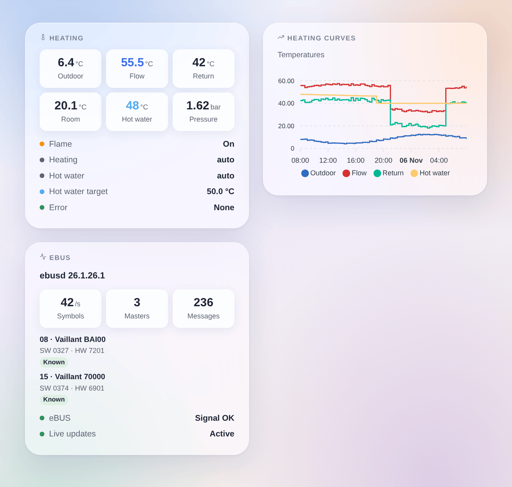

# ebusd

## Overview

This integration brings your eBUS heating into Gladys: Vaillant, Saunier Duval, AWB, Bulex, Wolf, Kromschröder and the other brands whose boilers, heat pumps and controllers talk over the eBUS. It goes through [ebusd](https://github.com/john30/ebusd), a free program that listens to the bus with an eBUS adapter and knows the messages of each device.

Each eBUS device ebusd knows becomes a Gladys device: the boiler, the heat pump, the controller, the heating circuits, plus ebusd itself with the eBUS signal. Values that change on the bus arrive live; the others are read every few minutes. Everything stays on your local network.

Unofficial integration, not affiliated with the ebusd project or the brands above.

## Requirements

- Gladys Assistant 5.3.0 or later.
- ebusd running on a Raspberry Pi, a NAS, the Gladys machine (Docker image `john30/ebusd`) or as a Home Assistant add-on, with an eBUS adapter (for example the eBUS Adapter Shield).
- ebusd with its configuration files (the default) and its TCP port 8888 reachable from Gladys: do not start it with `--localhost`. Check with `ebusctl info` that it sees your devices and shows a `loaded` configuration for each.

## Configuration

### ebusd

- **Address of ebusd**: the IP address or the name of the machine running ebusd. `localhost` does not work: Gladys runs the integration in its own container.
- **TCP port**: 8888 unless you changed `--port`.
- **User** and **secret**: only if ebusd uses an access file (`--aclfile`).
- **Reading interval**: 1 to 10 minutes (2 by default). The eBUS is slow and shared with your heating; values that change arrive live anyway.
- **Values offered**: the useful ones (temperatures, pressure, flame, modulation, power, energy, hours, starts, modes, error), or every value ebusd has seen.
- **Extra messages**: messages always offered and read, as ebusd names them (`ebusctl find`), for example `bai.PumpPower, 700.Z1NightTemp`.
- **Language**: the language of the device and feature names and of the error messages.
- **Detailed log**: also writes every command sent to ebusd and its answer in the logs (never the secret). Turn it on to look into a problem, then off again.

Press **Test ebusd and search the devices**: the answer gives the ebusd version, the eBUS signal and the devices found with their number of values.

### Changing settings

Off by default: Gladys only reads. Tick **Allow changes** to let Gladys change what the controller opens to everyone:

- room targets (day, night…): 5 to 30 °C;
- hot water target: 35 to 70 °C;
- on / off and operating modes (heating, hot water: off, auto, day, night…).

Never the installer or service settings. The same value is never written twice, one message at most once a minute, 100 changes a day at most; the value is read back after writing.

## Usage

### Devices

In **Integrations → ebusd → Discover**, add the devices you want:

- **ebusd**: the eBUS signal (on when the adapter hears the bus);
- one device per eBUS circuit, named after its kind and model, for example **Boiler bai (Vaillant BAI00)** or **Controller 700 (Vaillant 70000)**.

Their features are the useful values: flow, return, outdoor, room, hot water and tank temperatures, water pressure, flame, modulation, hours and starts, heating and hot water modes, current error… A new device appears a few minutes after ebusd loads its configuration: press **Scan** again.

### Widgets

- **Heating**: the main temperatures, pressure and modulation, live, then flame, modes, hot water target and current error.
- **Heating curves**: outdoor, flow, return and hot water temperatures over 24 hours, 3 or 7 days.
- **eBUS**: ebusd, the bus traffic and the devices seen with their model and software.

### Scenes

Triggers: **An eBUS device reports an error** (with the error code), **An eBUS error is cleared**, **ebusd stops answering**, **ebusd answers again**.

Actions: **Read an eBUS value** (any message by circuit and name: value, number, unit, every field) and **Write an eBUS value** (a message open to everyone, when changes are allowed).

Examples:

- When the boiler reports an error, send a message with the error code.
- When ebusd stops answering, notify: the house may not be heated.
- Every morning, read `bai WaterPressure`; below 1 bar, remind to top up the heating.

## Troubleshooting

- **ebusd does not answer**: check the address and the port, that ebusd listens on the network (not `--localhost`) and that no firewall blocks port 8888.
- **No eBUS signal**: ebusd runs but the adapter hears nothing; check the adapter, its wiring and `ebusctl state`.
- **A device or a value is missing**: wait until ebusd loads the configuration of the device (`ebusctl info`), then search again; choose "every value ebusd has seen" or list the message in "Extra messages".
- **A change is refused**: tick **Allow changes**; the same message can change once a minute; installer settings are never written.
- Logs: the **Logs** tab of the integration page. They always say when ebusd stops answering (with the reason) and what each search found; tick **Detailed log** to also see every command and its answer.
