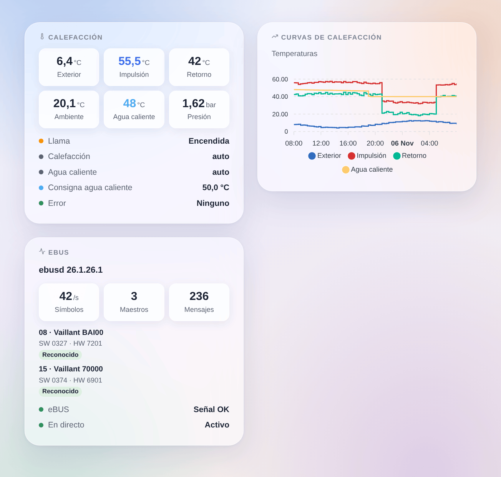

# ebusd

## Presentación

Esta integración lleva a Gladys su calefacción eBUS: Vaillant, Saunier Duval, AWB, Bulex, Wolf, Kromschröder y las demás marcas cuyas calderas, bombas de calor y reguladores se comunican por el eBUS. Pasa por [ebusd](https://github.com/john30/ebusd), un programa libre que escucha el bus con un adaptador eBUS y conoce los mensajes de cada dispositivo.

Cada dispositivo eBUS que ebusd conoce se convierte en un dispositivo de Gladys: la caldera, la bomba de calor, el regulador, los circuitos de calefacción, además del propio ebusd con la señal eBUS. Los valores que cambian en el bus llegan en directo; los demás se leen cada pocos minutos. Todo se queda en su red local.

Integración no oficial, sin relación con el proyecto ebusd ni con las marcas citadas.

## Requisitos

- Gladys Assistant 5.3.0 o posterior.
- ebusd funcionando en una Raspberry Pi, un NAS, el equipo de Gladys (imagen Docker `john30/ebusd`) o como complemento de Home Assistant, con un adaptador eBUS (por ejemplo el eBUS Adapter Shield).
- ebusd con sus archivos de configuración (por defecto) y su puerto TCP 8888 accesible desde Gladys: no lo inicie con `--localhost`. Compruebe con `ebusctl info` que ve sus dispositivos y que muestra una configuración `loaded` para cada uno.

## Configuración

### ebusd

- **Dirección de ebusd**: la dirección IP o el nombre del equipo donde funciona ebusd. `localhost` no funciona: Gladys ejecuta la integración en su propio contenedor.
- **Puerto TCP**: 8888, salvo que haya cambiado `--port`.
- **Usuario** y **secreto**: solo si ebusd usa un archivo de acceso (`--aclfile`).
- **Intervalo de lectura**: de 1 a 10 minutos (2 por defecto). El eBUS es lento y compartido con su calefacción; de todos modos, los valores que cambian llegan en directo.
- **Valores ofrecidos**: los útiles (temperaturas, presión, llama, modulación, potencia, energía, horas, arranques, modos, error), o todos los que ebusd ha visto.
- **Mensajes adicionales**: mensajes que siempre se ofrecen y se leen, con el nombre que les da ebusd (`ebusctl find`), por ejemplo `bai.PumpPower, 700.Z1NightTemp`.
- **Idioma de los nombres y textos**: el idioma de los nombres de dispositivos y funciones y de los mensajes de error.
- **Registro detallado**: escribe también en los logs cada comando enviado a ebusd y su respuesta (nunca el secreto). Actívelo para estudiar un problema y desactívelo después.

Pulse **Probar ebusd y buscar los dispositivos**: la respuesta indica la versión de ebusd, la señal eBUS y los dispositivos encontrados con su número de valores.

### Cambiar ajustes

Desactivado por defecto: Gladys solo lee. Marque **Permitir cambios** para que Gladys pueda cambiar lo que el regulador deja cambiar a todos:

- consignas de ambiente (día, noche…): de 5 a 30 °C;
- consigna de agua caliente: de 35 a 70 °C;
- encendido / apagado y modos de funcionamiento (calefacción, agua caliente: apagado, auto, día, noche…).

Nunca los ajustes de instalador o de servicio técnico. Nunca se escribe dos veces el mismo valor, un mismo mensaje como máximo una vez por minuto, 100 cambios al día como máximo; el valor se vuelve a leer después de escribirlo.

## Uso

### Dispositivos

En **Integraciones → ebusd → Descubrir**, añada los dispositivos que quiera:

- **ebusd**: la señal eBUS (encendida cuando el adaptador oye el bus);
- un dispositivo por cada circuito eBUS, con el nombre de su tipo y su modelo, por ejemplo **Caldera bai (Vaillant BAI00)** o **Regulador 700 (Vaillant 70000)**.

Sus funciones son los valores útiles: temperaturas de impulsión, retorno, exterior, ambiente, agua caliente y depósito, presión del agua, llama, modulación, horas y arranques, modos de calefacción y de agua caliente, error actual… Un dispositivo nuevo aparece unos minutos después de que ebusd cargue su configuración: vuelva a pulsar **Buscar**.

### Widgets

- **Calefacción**: las temperaturas principales, la presión y la modulación, en directo, y después la llama, los modos, la consigna de agua caliente y el error actual.
- **Curvas de calefacción**: temperaturas exterior, de impulsión, de retorno y de agua caliente durante 24 horas, 3 o 7 días.
- **eBUS**: ebusd, el tráfico del bus y los dispositivos vistos con su modelo y su software.

### Escenas

Desencadenadores: **Un dispositivo eBUS indica un error** (con el código de error), **Un error eBUS desaparece**, **ebusd deja de responder**, **ebusd vuelve a responder**.

Acciones: **Leer un valor eBUS** (cualquier mensaje por su circuito y su nombre: valor, valor numérico, unidad, todos los campos) y **Escribir un valor eBUS** (un mensaje abierto a todos, cuando los cambios están permitidos).

Ejemplos:

- Cuando la caldera indica un error, enviar un mensaje con el código de error.
- Cuando ebusd deja de responder, avisar: puede que la casa no se esté calentando.
- Cada mañana, leer `bai WaterPressure`; por debajo de 1 bar, recordar que hay que rellenar la calefacción.

## Solución de problemas

- **ebusd no responde**: compruebe la dirección y el puerto, que ebusd escucha en la red (no con `--localhost`) y que ningún cortafuegos bloquea el puerto 8888.
- **Sin señal eBUS**: ebusd funciona pero el adaptador no oye nada; compruebe el adaptador, su cableado y `ebusctl state`.
- **Falta un dispositivo o un valor**: espere a que ebusd cargue la configuración del dispositivo (`ebusctl info`) y vuelva a buscar; elija «Todos los que ebusd ha visto» o indique el mensaje en «Mensajes adicionales».
- **Se rechaza un cambio**: marque **Permitir cambios**; un mismo mensaje solo puede cambiar una vez por minuto; los ajustes de instalador nunca se escriben.
- Logs: la pestaña **Logs** de la página de la integración. Indican siempre cuándo ebusd deja de responder (con el motivo) y lo que encontró cada búsqueda; marque **Registro detallado** para ver también cada comando y su respuesta.
