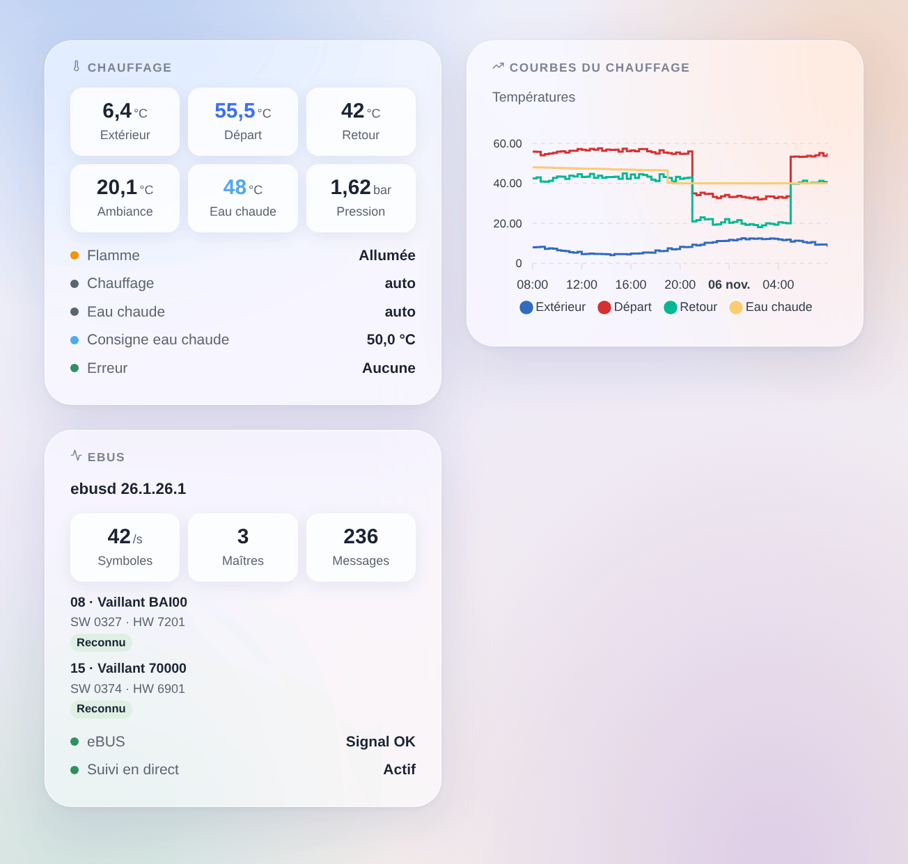

# ebusd

## Présentation

Cette intégration fait entrer votre chauffage eBUS dans Gladys : Vaillant, Saunier Duval, AWB, Bulex, Wolf, Kromschröder et les autres marques dont les chaudières, pompes à chaleur et régulateurs dialoguent sur l’eBUS. Elle passe par [ebusd](https://github.com/john30/ebusd), un programme libre qui écoute le bus au moyen d’un adaptateur eBUS et connaît les messages de chaque appareil.

Chaque appareil eBUS connu d’ebusd devient un appareil Gladys : la chaudière, la pompe à chaleur, le régulateur, les circuits de chauffage, plus ebusd lui-même avec le signal eBUS. Les valeurs qui changent sur le bus arrivent en direct ; les autres sont lues toutes les quelques minutes. Tout reste sur votre réseau local.

Intégration non officielle, sans lien avec le projet ebusd ni les marques citées.

## Prérequis

- Gladys Assistant 5.3.0 ou plus récent.
- ebusd qui tourne sur un Raspberry Pi, un NAS, la machine de Gladys (image Docker `john30/ebusd`) ou en module complémentaire Home Assistant, avec un adaptateur eBUS (par exemple l’eBUS Adapter Shield).
- ebusd avec ses fichiers de configuration (par défaut) et son port TCP 8888 joignable depuis Gladys : ne le lancez pas avec `--localhost`. Vérifiez avec `ebusctl info` qu’il voit vos appareils et affiche une configuration `loaded` pour chacun.

## Configuration

### ebusd

- **Adresse d’ebusd** : l’adresse IP ou le nom de la machine où tourne ebusd. `localhost` ne fonctionne pas : Gladys fait tourner l’intégration dans son propre conteneur.
- **Port TCP** : 8888 sauf si vous avez changé `--port`.
- **Utilisateur** et **secret** : seulement si ebusd utilise un fichier d’accès (`--aclfile`).
- **Intervalle de lecture** : de 1 à 10 minutes (2 par défaut). L’eBUS est lent et partagé avec votre chauffage ; les valeurs qui changent arrivent de toute façon en direct.
- **Valeurs proposées** : les valeurs utiles (températures, pression, flamme, modulation, puissance, énergie, heures, démarrages, modes, erreur), ou toutes celles qu’ebusd a vues.
- **Messages en plus** : des messages toujours proposés et lus, nommés comme dans ebusd (`ebusctl find`), par exemple `bai.PumpPower, 700.Z1NightTemp`.
- **Langue** : la langue des noms d’appareils et de fonctionnalités et des messages d’erreur.
- **Journal détaillé** : écrit aussi dans les journaux chaque commande envoyée à ebusd et sa réponse (jamais le secret). À activer pour étudier un problème, puis à désactiver.

Appuyez sur **Tester ebusd et chercher les appareils** : la réponse donne la version d’ebusd, le signal eBUS et les appareils trouvés avec leur nombre de valeurs.

### Modifier les réglages

Désactivé par défaut : Gladys ne fait que lire. Cochez **Autoriser les modifications** pour que Gladys puisse changer ce que le régulateur ouvre à tout le monde :

- les consignes ambiantes (jour, nuit…) : de 5 à 30 °C ;
- la consigne d’eau chaude : de 35 à 70 °C ;
- les marches/arrêts et les modes de fonctionnement (chauffage, eau chaude : off, auto, jour, nuit…).

Jamais les réglages installateur ou SAV. Une même valeur n’est jamais réécrite, un même message au plus une fois par minute, 100 modifications par jour au maximum ; la valeur est relue après l’écriture.

## Utilisation

### Appareils

Dans **Intégrations → ebusd → Découverte**, ajoutez les appareils voulus :

- **ebusd** : le signal eBUS (allumé quand l’adaptateur entend le bus) ;
- un appareil par circuit eBUS, nommé d’après son type et son modèle, par exemple **Chaudière bai (Vaillant BAI00)** ou **Régulateur 700 (Vaillant 70000)**.

Leurs fonctionnalités sont les valeurs utiles : températures de départ, de retour, extérieure, ambiante, d’eau chaude et du ballon, pression d’eau, flamme, modulation, heures et démarrages, modes chauffage et eau chaude, erreur en cours… Un nouvel appareil apparaît quelques minutes après qu’ebusd a chargé sa configuration : relancez **Scanner**.

### Widgets

- **Chauffage** : les principales températures, la pression et la modulation, en direct, puis la flamme, les modes, la consigne d’eau chaude et l’erreur en cours.
- **Courbes du chauffage** : températures extérieure, de départ, de retour et d’eau chaude sur 24 heures, 3 ou 7 jours.
- **eBUS** : ebusd, le trafic du bus et les appareils vus avec leur modèle et leur logiciel.

### Scènes

Déclencheurs : **Un appareil eBUS signale une erreur** (avec le code d’erreur), **Une erreur eBUS disparaît**, **ebusd ne répond plus**, **ebusd répond de nouveau**.

Actions : **Lire une valeur eBUS** (n’importe quel message par circuit et nom : valeur, nombre, unité, tous les champs) et **Écrire une valeur eBUS** (un message ouvert à tous, quand les modifications sont autorisées).

Exemples :

- Quand la chaudière signale une erreur, envoyer un message avec le code d’erreur.
- Quand ebusd ne répond plus, prévenir : la maison n’est peut-être plus chauffée.
- Chaque matin, lire `bai WaterPressure` ; sous 1 bar, rappeler de remettre en pression le chauffage.

## Dépannage

- **ebusd ne répond pas** : vérifiez l’adresse et le port, qu’ebusd écoute sur le réseau (pas `--localhost`) et qu’aucun pare-feu ne bloque le port 8888.
- **Pas de signal eBUS** : ebusd tourne mais l’adaptateur n’entend rien ; vérifiez l’adaptateur, son câblage et `ebusctl state`.
- **Un appareil ou une valeur manque** : attendez qu’ebusd charge la configuration de l’appareil (`ebusctl info`), puis relancez la recherche ; choisissez « Toutes celles qu’ebusd a vues » ou indiquez le message dans « Messages en plus ».
- **Une modification est refusée** : cochez **Autoriser les modifications** ; un même message peut changer une fois par minute ; les réglages installateur ne sont jamais écrits.
- Journaux : l’onglet **Journaux** de la page de l’intégration. Ils disent toujours quand ebusd ne répond plus (avec la raison) et ce que chaque recherche a trouvé ; cochez **Journal détaillé** pour voir aussi chaque commande et sa réponse.
